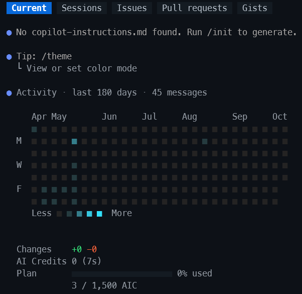
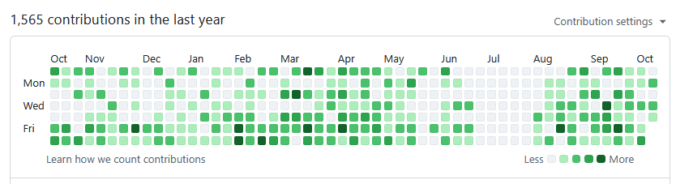
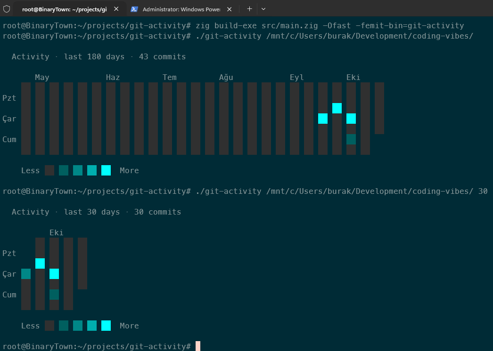
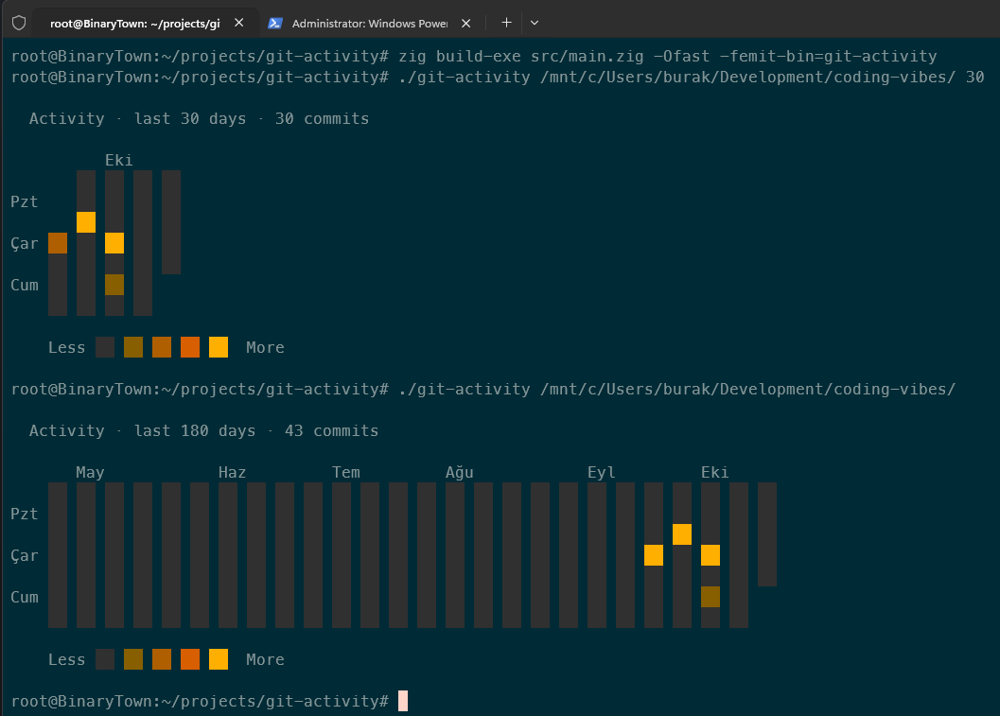

# Git Activity Dashboard

Copilot CLI ile çalıştığım bir gün `/usage` komutu ile geçmiş aktivitilerimi görüntülemiştim.



Aslında benzer bir görünüm hepimizin bildiği üzere github profil sayfalarımızda da oluyor. Geçmişe yönelik olarak günlük commit sayılarımıza göre yeşil rengin tonları da değişiyor.



Bunun üzerine benzer şeyi terminalde gösteren ve local repo'larda çalışan çok basit bir CLI aracını Zig dili ile yazabilir miyim diye düşünmeye başladım. Çok az bir zamanda olsa Zig programlama diline bakmıştım ama hiçbir şeyi hatırlamıyordum. Bu yüzden GPT'den bir öğreti hazırlamasını istedim. İşte buradaki örnek [o öğretinin](./docs/zig-git-activity-tutorial.md) bir sonucu.

## Kurulum ve Kullanım

Öğretiyi hazırlarken Zig dilinin son stabil sürümünü kullanmasını, C# ve Rust tecrübem olduğu için kullanılan materyallerin bu dillerle karşılaştırılmasını, örneği Windows ortamında WSL üzerinden çalıştırmayı hedeflediğimi belirttim.

Örneği çalıştırmak son derece kolay. Aşağıdaki adımları takip edebilirsiniz.

```bash
# WSL ortamındayken
# Önce projeyi bir derleyelim
zig build-exe src/main.zig -Ofast -femit-bin=git-activity

# Çalıştırmak için (Varsayılan 180 gün geriye gider)
./git-activity ~/projects/my-rust-project.

# Ama örneğin sadece 60 günlük aktivite geçmişini de alabiliriz
./git-activity ~/projects/my-rust-project 60
```



Birde farklı renk paleti uygulanmış hali.


