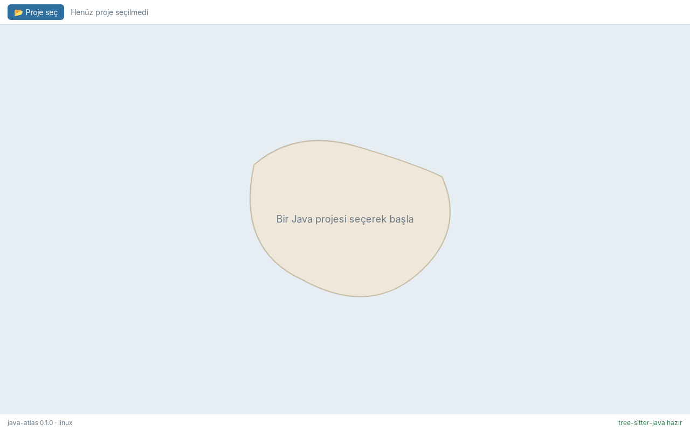

# Faz 0 — Atölye Kurulumu ve İskelet

> **Önceki:** [PLAN.md](../PLAN.md) · **Sonraki:** 01 — Build dosyalarını okumak *(yazılacak)*

## 1. Bu bölümde ne yapacağız

Araç zincirini kurup java-atlas'ın iskeletini ayağa kaldıracağız: kökte bir **Cargo workspace**, içinde iki kütüphane crate'i (`java-atlas-core`, `java-atlas-scan`) ve Tauri uygulaması (`src-tauri`); yanında **Svelte 5 + TypeScript + Vite** ön yüzü.

Bölümün sonunda:

- `npm run tauri dev` bir pencere açar; denizin ortasında boş bir ada ve **"📂 Proje seç"** düğmesi vardır.
- Düğme işletim sisteminin klasör seçicisini açar, seçilen yol üst çubukta görünür.
- Alt durum çubuğu Rust tarafına sorar ve **"tree-sitter-java hazır"** yazar.
- `cargo test --workspace` yeşildir.



## 2. Neden böyle

### Workspace ve bağımlılık yönü

easy-git'teki yapının aynısı, crate adları farklı:

```
java-atlas/
├── Cargo.toml                  ← workspace kökü
├── crates/
│   ├── java-atlas-core/        ← domain + analiz + yerleşim (diskten, parser'dan, Tauri'den habersiz)
│   └── java-atlas-scan/        ← diskteki proje → olgular (build dosyaları, tree-sitter)
├── src-tauri/                  ← Tauri uygulaması
├── src/                        ← Svelte ön yüz
├── samples/                    ← örnek Java projeleri (Faz 1)
└── docs/
```

Bağımlılık yönü: `src-tauri → java-atlas-scan → java-atlas-core`. `java-atlas-core`'un `[dependencies]` bölümü **bilerek boş**; çekirdeğin hiçbir altyapıya bağımlı olmadığını derleyici garanti ediyor.

easy-git'te adaptör crate'inin adı `easy-git-repo` idi (git'e erişen taraf). Burada `scan` dedik, çünkü tek bir kaynaktan değil, birçok dosya türünden (POM, Gradle, TOML, Java) okuma yapıyor.

### Neden Faz 0'da tree-sitter?

İskelet fazında normalde iş mantığı olmaz. Ama `tree-sitter-java` sıradan bir Rust crate'i değil: Java grameri **C ile yazılmış bir ayrıştırıcıdır** ve crate'in `build.rs` dosyası onu `cc` crate'i ile derler. Yani:

- Windows'ta **MSVC** (Visual Studio Build Tools, *Desktop development with C++*),
- Ubuntu'da **gcc** (`build-essential`)

olmadan derleme başarısız olur. Bu sorunu Faz 2'de, kafamız ayrıştırma algoritmasıyla doluyken değil, şimdi yaşamak istiyoruz. Bu yüzden `java-atlas-scan`'e küçük bir duman testi koyduk: grameri yükle, bir dosyanın `package` bildirimini oku.

### `tree-sitter` ile `tree-sitter-java` sürümleri

Grameri çekirdek kütüphaneye bağlamanın yolu sürümden sürüme değişti. Güncel kalıp:

```rust
parser.set_language(&tree_sitter_java::LANGUAGE.into())?;
```

`LANGUAGE` bir `LanguageFn`'dir; `.into()` onu çekirdeğin `Language` tipine çevirir. Eski blog yazılarında görülen `tree_sitter_java::language()` artık yok. Uyumlu ikili: **`tree-sitter = 0.27`**, **`tree-sitter-java = 0.23`**.

### Tauri 2'de kalıyoruz

crates.io'da Tauri 3.0 alpha sürümleri görünüyor. Atölyenin amacı Tauri'nin alfa sürümüyle boğuşmak değil; easy-git'te öğrendiğimiz Tauri 2 kalıplarını (command, state, capability) taşıyıp üstüne yenilerini (channel) eklemek. `tauri = "2.12"`.

### Çapraz platform ayarı

`tauri.conf.json` içinde `"bundle.targets": "all"` — easy-git'te sadece `["msi", "nsis"]` vardı. Paketleme Faz 10'da, ama hedefi baştan doğru koyuyoruz. Pencerenin `label`'ı da açıkça `"main"` yazıldı; capability dosyası bu etikete izin veriyor.

## 3. Adım adım uygulama

### 3.1 Araç zinciri

| Araç | Windows 11 | Ubuntu | Kontrol |
|---|---|---|---|
| C/C++ derleyici | VS Build Tools — *Desktop development with C++* | `sudo apt install build-essential` | — |
| Rust | `rustup default stable-x86_64-pc-windows-msvc` | `rustup default stable` | `rustc --version` (≥ 1.90) |
| Node.js | LTS | LTS | `node --version` (≥ 20) |
| WebView | WebView2 (hazır gelir) | aşağıdaki paketler | — |

Ubuntu'da Tauri 2 için sistem paketleri:

```bash
sudo apt install libwebkit2gtk-4.1-dev libgtk-3-dev librsvg2-dev \
  libayatana-appindicator3-dev libssl-dev pkg-config
```

### 3.2 Workspace kökü — `Cargo.toml`

```toml
[workspace]
resolver = "3"
members = ["crates/java-atlas-core", "crates/java-atlas-scan", "src-tauri"]

[workspace.package]
version = "0.1.0"
edition = "2024"
rust-version = "1.90"
license = "MIT"
authors = ["Burak Selim Senyurt"]

[workspace.dependencies]
java-atlas-core = { path = "crates/java-atlas-core" }
java-atlas-scan = { path = "crates/java-atlas-scan" }
serde = { version = "1", features = ["derive"] }
serde_json = "1"
thiserror = "2"
tree-sitter = "0.27"
tree-sitter-java = "0.23"

[profile.dev.package."*"]
opt-level = 1
```

Son iki satır: debug derlemede bile **bağımlılıklar** hafif optimize edilir. Kendi kodumuz hızlı derlenmeye devam eder; tree-sitter ise binlerce dosyayı ayrıştırırken sürünmez.

### 3.3 `java-atlas-core` — haritanın sözlüğü

Faz 0'da çekirdekte sadece atlasın üç ölçeği var (PLAN 3.1):

```rust
// crates/java-atlas-core/src/lib.rs
#[derive(Debug, Clone, Copy, PartialEq, Eq)]
pub enum Scale {
    Country,
    Region,
    City,
}

impl Scale {
    pub fn zoom_in(self) -> Option<Scale> {
        match self {
            Scale::Country => Some(Scale::Region),
            Scale::Region => Some(Scale::City),
            Scale::City => None,
        }
    }

    pub fn zoom_out(self) -> Option<Scale> {
        match self {
            Scale::Country => None,
            Scale::Region => Some(Scale::Country),
            Scale::City => Some(Scale::Region),
        }
    }
}
```

Testlerden biri "yakınlaşıp uzaklaşmak başa döndürür" özelliğini **tüm ölçekler için** dener — tek tek örnek yazmak yerine bir özelliği (property) sınamanın en küçük hâli.

### 3.4 `java-atlas-scan` — tree-sitter ile ilk temas

```toml
# crates/java-atlas-scan/Cargo.toml
[dependencies]
java-atlas-core.workspace = true
thiserror.workspace = true
tree-sitter.workspace = true
tree-sitter-java.workspace = true
```

```rust
// crates/java-atlas-scan/src/lib.rs
use thiserror::Error;
use tree_sitter::Parser;

#[derive(Debug, Error)]
pub enum ScanError {
    #[error("the Java grammar could not be loaded: {0}")]
    Grammar(#[from] tree_sitter::LanguageError),
    #[error("the parser returned no syntax tree")]
    NoTree,
}

pub fn java_parser() -> Result<Parser, ScanError> {
    let mut parser = Parser::new();
    parser.set_language(&tree_sitter_java::LANGUAGE.into())?;
    Ok(parser)
}

pub fn declared_package(source: &str) -> Result<Option<String>, ScanError> {
    let mut parser = java_parser()?;
    let tree = parser.parse(source, None).ok_or(ScanError::NoTree)?;
    let root = tree.root_node();

    let mut cursor = root.walk();
    let package = root
        .children(&mut cursor)
        .find(|node| node.kind() == "package_declaration")
        .and_then(|decl| {
            let mut inner = decl.walk();
            decl.named_children(&mut inner)
                .find(|n| matches!(n.kind(), "scoped_identifier" | "identifier"))
                .and_then(|name| name.utf8_text(source.as_bytes()).ok())
                .map(str::to_owned)
        });
    Ok(package)
}
```

Dikkat edilecekler:

- **`#[from]`** — `?` operatörü `LanguageError`'ı otomatik olarak `ScanError::Grammar`'a çevirir.
- **Söz dizimi ağacı (CST)**: `package com.atlasbank.service;` satırı `package_declaration` düğümüdür; içindeki ad tek parçalıysa `identifier`, noktalıysa `scoped_identifier`. Faz 2'de bu düğüm türlerinin tamamını tanıyacağız.
- **`TreeCursor`** — `children()` bir cursor ister; ağaçta ileri-geri gezinmek için tahsis (allocation) yapmayan yardımcı.
- **`utf8_text`** — düğüm metni kopyalamaz, kaynak metindeki bayt aralığını gösterir. Bu yüzden `source.as_bytes()` veriliyor.

Testlerdeki en öğretici örnek, **yarım yazılmış** bir dosya:

```rust
let src = "package com.atlasbank.api;\npublic class Broken { void f( {";
assert_eq!(declared_package(src).unwrap().as_deref(), Some("com.atlasbank.api"));
```

tree-sitter hataya dayanıklıdır: sözdizimi hatası olan bölgeyi `ERROR` düğümü olarak işaretler, geri kalan ağacı yine kurar. Gerçek projelerde derlenmeyen bir dosya yüzünden tüm haritanın çökmemesi bu sayede.

### 3.5 Tauri kabuğu

```toml
# src-tauri/Cargo.toml (özet)
[lib]
name = "java_atlas_lib"
crate-type = ["staticlib", "cdylib", "rlib"]

[dependencies]
java-atlas-core.workspace = true
java-atlas-scan.workspace = true
tauri = { version = "2.12", features = [] }
tauri-plugin-dialog = "2.8"
serde.workspace = true
serde_json.workspace = true
thiserror.workspace = true
```

Tek bir sağlık kontrolü command'ı:

```rust
// src-tauri/src/commands.rs
#[derive(Debug, Serialize)]
#[serde(rename_all = "camelCase")]
pub struct AppInfo {
    pub version: &'static str,
    pub platform: &'static str,
    pub java_grammar_ok: bool,
}

#[tauri::command]
pub fn app_info() -> AppInfo {
    AppInfo {
        version: env!("CARGO_PKG_VERSION"),
        platform: std::env::consts::OS,
        java_grammar_ok: java_atlas_scan::java_parser().is_ok(),
    }
}
```

`#[serde(rename_all = "camelCase")]` — Rust'ta `java_grammar_ok`, TypeScript'te `javaGrammarOk`. Her iki dil kendi adlandırma kuralında kalır. (Faz 4'te bu tipleri `ts-rs` ile üreteceğiz; şimdilik tek arayüz elle yazıldı.)

```rust
// src-tauri/src/lib.rs
mod commands;

#[cfg_attr(mobile, tauri::mobile_entry_point)]
pub fn run() {
    tauri::Builder::default()
        .plugin(tauri_plugin_dialog::init())
        .invoke_handler(tauri::generate_handler![commands::app_info])
        .run(tauri::generate_context!())
        .expect("error while running java-atlas");
}
```

**Capability** — ön yüz sadece listelenen izinleri kullanabilir:

```json
// src-tauri/capabilities/default.json
{
  "identifier": "default",
  "windows": ["main"],
  "permissions": ["core:default", "dialog:allow-open"]
}
```

`dialog:allow-open` olmadan "Proje seç" düğmesi konsolda izin hatası verir. Bunu bir kez kendin dene: satırı sil, düğmeye bas, hatayı gör, geri ekle.

### 3.6 Ön yüz

Dosyalar: `package.json`, `vite.config.ts`, `svelte.config.js`, `tsconfig.json`, `index.html`, `src/main.ts`, `src/App.svelte`, `src/app.css`, `src/lib/api.ts`.

Tüm IPC çağrıları tek dosyada toplanır:

```ts
// src/lib/api.ts
import { invoke } from "@tauri-apps/api/core";
import { open } from "@tauri-apps/plugin-dialog";

export interface AppInfo {
  version: string;
  platform: string;
  javaGrammarOk: boolean;
}

export function appInfo(): Promise<AppInfo> {
  return invoke<AppInfo>("app_info");
}

export async function pickProjectFolder(): Promise<string | null> {
  const picked = await open({ directory: true, multiple: false, title: "Java projesi seç" });
  return typeof picked === "string" ? picked : null;
}
```

`App.svelte` Svelte 5 rune'larıyla üç durumu tutar (`info`, `error`, `projectPath`) ve açılışta `$effect` içinde `app_info`'yu çağırır. Ortadaki ada şimdilik elle çizilmiş tek bir SVG `path`; gerçek kara parçası Faz 5'te treemap'ten gelecek.

Renkler `app.css`'te CSS değişkenleri olarak tanımlı ve `prefers-color-scheme: dark` ile koyu temaya geçer — PLAN'daki deniz/kara tonları baştan yerinde.

### 3.7 Simge

Uygulama simgesi `docs/images/app-icon.svg` (deniz üstünde ada, yollar, kırmızı bir "döngü" düğümü). Tüm platform boyutları tek komutla üretildi:

```bash
npx tauri icon docs/images/app-icon.svg
```

Komut Android/iOS klasörleri de üretir; masaüstü uygulaması olduğumuz için `src-tauri/icons/android` ve `ios` silindi.

### 3.8 Çalıştır

```bash
npm install
cargo test --workspace     # 8 test: core 2, scan 5, src-tauri 1
npm run check              # svelte-check: 0 hata
npm run tauri dev
```

## 4. Takıldığın yerler

| Belirti | Neden | Çözüm |
|---|---|---|
| Windows: `tree-sitter-java` derlenirken `cl.exe` bulunamadı / `link.exe` hatası | MSVC ortam değişkenleri yüklenmemiş | easy-git'teki çözüm: komutları **Developer Command Prompt for VS** (ya da Developer PowerShell) içinden çalıştır; kalıcı çözüm için VS Installer'da *Desktop development with C++* iş yükünün tam kurulu olduğunu kontrol et |
| Ubuntu: `cc: not found` | C derleyicisi yok | `sudo apt install build-essential` |
| Ubuntu: `webkit2gtk-4.1 was not found` | Tauri sistem paketleri eksik | 3.1'deki `apt install` satırı |
| `LanguageError: Incompatible language version` | `tree-sitter` ile gramer crate'inin ABI sürümleri uyuşmuyor | Sürümleri 0.27 / 0.23'te tut; gramer güncellenirse ikisini birlikte yükselt |
| "Proje seç" tıklanınca `dialog.open not allowed` | Capability eksik | `dialog:allow-open` |
| Ubuntu/VM'de pencere boş ya da EGL uyarıları | Sanal makinede GPU hızlandırması yok | `WEBKIT_DISABLE_COMPOSITING_MODE=1 npm run tauri dev` |

## 5. Ne öğrendik

- C kütüphanesi saran bir crate'in (`tree-sitter-java`) `build.rs` üzerinden derlendiğini ve bunun platforma göre farklı araç zinciri istediğini.
- tree-sitter'ın temel nesnelerini: `Parser`, `Tree`, `Node`, `TreeCursor`; düğüm türü (`kind`) ve isimli/isimsiz çocuk ayrımını.
- Hataya dayanıklı ayrıştırmanın, gerçek dünyadaki yarım dosyalar için neden önemli olduğunu.
- `thiserror` ile `#[from]` dönüşümünü.
- Tauri 2'de command → `invoke`, plugin → capability zincirini; `serde` ile adlandırma köprüsünü.
- Çapraz platform hedefini (`bundle.targets: "all"`) ve Linux bağımlılıklarını.

## 6. Kendin dene

1. `declared_package` fonksiyonunu, paket bildiriminden **önce** bir annotation olan dosya için dene (`@Deprecated package x;` — bu yalnızca `package-info.java` içinde geçerlidir). Ağaçta düğüm türü ne çıkıyor?
2. `java-atlas-scan`'e `fn count_imports(source: &str) -> usize` ekle; `import_declaration` düğümlerini say. Test olarak bir joker ve bir static import içeren dosya kullan. (Faz 2'nin küçük bir provası.)
3. Durum çubuğuna seçilen klasörde `pom.xml` ya da `settings.gradle(.kts)` olup olmadığını gösteren bir rozet ekle. İpucu: yeni bir command yaz; Rust tarafında `Path::join(..).exists()` yeterli.
