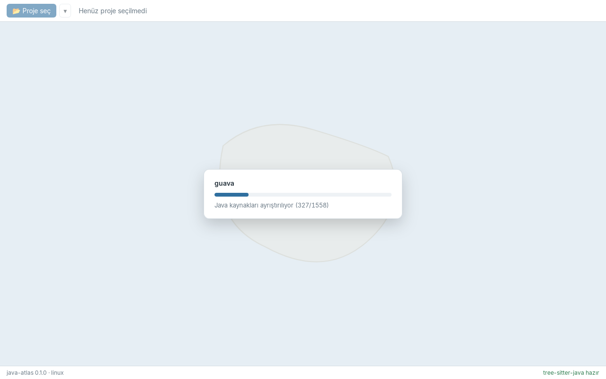
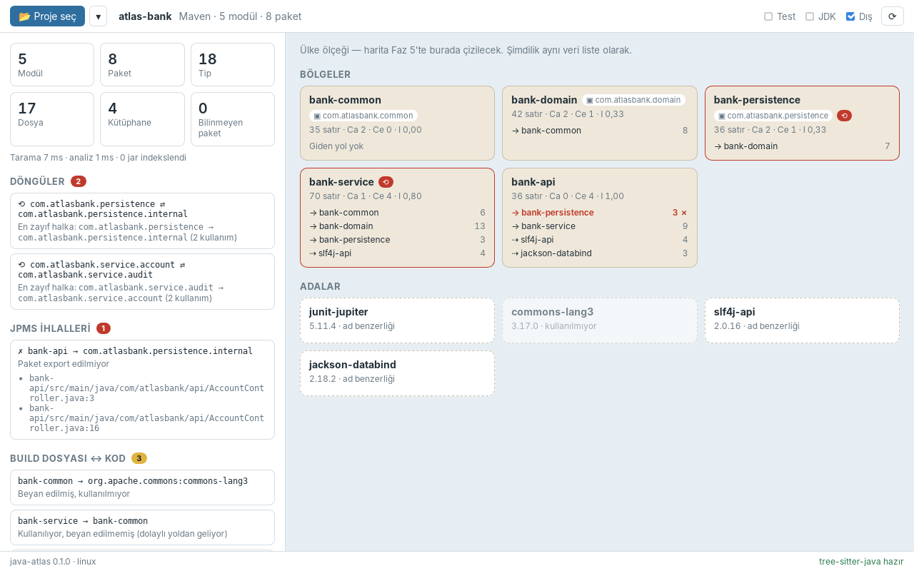

# Faz 4 — Tauri Köprüsü

> **Önceki:** [03 — Graf ve analiz](03-graf-ve-analiz.md) · **Sonraki:** [05 — Harita yerleşimi ve ilk çizim](05-treemap-ve-cizim.md)

## 1. Bu bölümde ne yapacağız

Üç fazdır Rust tarafında çalışıyoruz; sonuçları `inspect` örneğiyle terminalde görüyorduk. Bu fazda atlası **pencereye** taşıyoruz:

- **"Proje seç"** bir klasör seçtirir; tarama arka planda başlar.
- Tarama sırasında **ilerleme çubuğu** akar: "Java kaynakları ayrıştırılıyor (327/1558)".
- Bitince sol panelde **rapor** (sayılar, döngüler, JPMS ihlalleri, build dosyası bulguları, okuma uyarıları), sağda **ülke ölçeğinin verisi** liste olarak görünür. Harita çizimi Faz 5'te bu verinin üstüne gelecek.
- Son açılan projeler menüsü, filtreler (Test / JDK / Dış) ve yeniden tarama.





## 2. Neden böyle

### Komutlar, kanal ve görünüm isteği

easy-git'te her şey **istek/cevap** idi: ön yüz `invoke` ile sorar, Rust cevap döner. Burada iki yeni ihtiyaç var:

| İhtiyaç | Çözüm |
|---|---|
| Uzun süren işin **ara durumunu** göstermek | `tauri::ipc::Channel<T>`: komut çalışırken Rust'tan ön yüze akan mesajlar |
| Büyük projede tüm atlası ön yüze **göndermemek** | `get_atlas_view(scale, focus, filters)`: sadece o ekranın düğümleri ve yolları |

Guava'da atlas 3.520 tip, 47 paket ve binlerce kenar içeriyor. Hepsini JSON'a çevirip WebView'a göndermek hem yavaş hem gereksiz: ekranda aynı anda bir ölçek görünüyor. Ön yüz **görünüm** istiyor, Rust görünümü üretiyor.

### Görünüm mantığı neden core'da?

Hangi düğümlerin bir ekranda görüneceği ve yolların nasıl "katlanacağı" bir **iş kuralı**: Tauri'den bağımsız, test edilmesi gereken bir mantık. Bu yüzden `Atlas::view` core'da (`atlas/view.rs`), Tauri tarafı sadece DTO'ya çeviriyor.

| Ölçek | Üyeler | Yollar nereden | Diğer uç nasıl katlanır |
|---|---|---|---|
| Ülke | Modüller | Modül kenarları | — |
| Bölge (bir modül) | O modülün paketleri | Ona dokunan paket kenarları | Başka modülün paketi → **o modülün bölgesi** |
| Şehir (bir paket) | O paketin tipleri | Ona dokunan tip kenarları | Başka paketin tipi → **o paketin şehri** |

"Katlamak" haritadaki **sınır** fikrinin karşılığı: `bank-api` bölgesine yakınlaştığında `persistence.internal`'a giden yol, `bank-persistence` bölgesinin sınırında biter. Ayrıntısı o bölgeye girince görünür.

### Kararlı anahtarlar

`NodeId` bir dizi indeksi; her taramada değişebilir. Ön yüze **anahtar** gidiyor:

| Tür | Anahtar |
|---|---|
| Modül | `m:com.atlasbank:bank-api` |
| Paket | `p:com.atlasbank:bank-common\|com.atlasbank.common` |
| Tip | `t:com.atlasbank.common.Money` |
| Kütüphane | `l:org.slf4j:slf4j-api` |
| JDK / bilinmeyen | `j:java.util` / `u:org.mystery` |

Paket anahtarında modül de var, çünkü aynı paket adı iki modülde bulunabilir (bölünmüş paketler). Faz 8'de canlı izleme projeyi yeniden tarayınca seçili düğüm anahtarıyla korunacak.

## 3. Adım adım uygulama

### 3.1 Dosya düzeni

```
.cargo/config.toml                ← yeni: TS_RS_EXPORT_DIR, Windows için statik CRT
crates/java-atlas-core/src/atlas/
└── view.rs                       ← yeni: View, ViewFilters, key, evidence_between, sizes
src-tauri/src/
├── lib.rs                        ← plugin'ler, state, komut listesi
├── commands.rs                   ← #[tauri::command] fonksiyonları
├── project.rs                    ← yeni: tarama + OpenProject + DTO dönüşümleri
├── dto.rs                        ← yeni: IPC tipleri (ts-rs)
├── error.rs                      ← yeni: AppError
├── state.rs                      ← yeni: AppState
└── recent.rs                     ← yeni: son açılan projeler (tauri-plugin-store)
src/lib/
├── api.ts                        ← tüm invoke çağrıları
├── project.svelte.ts             ← uygulama durumu (Svelte 5 rune'ları)
├── format.ts
├── bindings/*.ts                 ← ts-rs'nin ürettiği tipler (elle düzenlenmez)
├── Toolbar.svelte
├── ScanOverlay.svelte
└── panels/
    ├── ReportPanel.svelte
    └── CountryPreview.svelte     ← Faz 5'te haritaya dönüşecek
```

### 3.2 `ts-rs`: tipler tek yerde

easy-git'teki kurulumun aynısı. `.cargo/config.toml`:

```toml
[env]
TS_RS_EXPORT_DIR = { value = "src/lib/bindings", relative = true }
```

Her DTO'ya:

```rust
#[derive(Debug, Clone, Serialize, TS)]
#[serde(rename_all = "camelCase")]
#[ts(export)]
pub struct NodeDto {
    pub key: String,
    pub kind: NodeKindDto,
    pub name: String,
    // …
    pub in_cycle: bool,
    pub metrics: Option<MetricsDto>,
}
```

`cargo test -p java-atlas` çalışınca `ts-rs` her `#[ts(export)]` tipi için bir test üretir ve `src/lib/bindings/NodeDto.ts` dosyasını yazar:

```ts
export type NodeDto = { key: string, kind: NodeKindDto, name: string, … inCycle: boolean, metrics: MetricsDto | null, … };
```

Rust tarafında bir alan eklenip `cargo test` çalıştırıldığında TypeScript dosyası değişir ve `npm run check` uyumsuzlukları yakalar. İki taraf elle senkron tutulmaz.

Bu fazdaki dikkat çekici tip, **etiketli enum**:

```rust
#[derive(Debug, Clone, Serialize, TS)]
#[serde(tag = "stage", rename_all = "camelCase")]
#[ts(export)]
pub enum ScanEvent {
    ReadingBuild,
    ParsingSources { done: u32, total: u32 },
    IndexingLibraries,
    Analysing,
}
```

```ts
export type ScanEvent =
  | { "stage": "readingBuild" }
  | { "stage": "parsingSources", done: number, total: number }
  | { "stage": "indexingLibraries" }
  | { "stage": "analysing" };
```

TypeScript'te bu bir **ayrımlı birleşim** (discriminated union): `switch (event.stage)` içinde `case "parsingSources":` dalında `event.done`'a erişmek tip güvenli. Rust'taki `match`'in TypeScript karşılığı.

### 3.3 Tarama ve kanal — `project.rs` + `commands.rs`

```rust
#[tauri::command]
pub async fn open_project(
    path: String,
    on_progress: Channel<ScanEvent>,
    app: AppHandle,
    state: State<'_, AppState>,
) -> Result<ProjectSummary, AppError> {
    let scanned = {
        let root = PathBuf::from(&path);
        tauri::async_runtime::spawn_blocking(move || {
            project::scan(&root, &|event| {
                let _ = on_progress.send(event);
            })
        })
        .await
        .map_err(join_error)?
    };
    // … hata ise son açılanlardan düş, değilse kaydet; state'e koy; özeti dön
}
```

- **`Channel<ScanEvent>`** bir komut parametresi gibi alınır. Ön yüz bir `Channel` nesnesi oluşturup `invoke`'a argüman olarak verir; Tauri onu iki tarafa bağlar.
- **`spawn_blocking`**: tarama CPU yoğun ve senkron (rayon kendi iş parçacıklarını kullanıyor). Async çalışma zamanının iş parçacıklarını bloklamamak için ayrı bir iş parçacığına taşınıyor.
- Kanal `move` ile kapanışa giriyor. `Channel` `Send + Sync` olduğu için hem `spawn_blocking`'e hem de rayon işçilerinden çağrılan ilerleme geri çağrısına girebiliyor. Derleyici bunu bizim yerimize denetliyor.

`project::scan` aşamaları ayrı ayrı çağırıyor, böylece her birinin başında bir olay gönderebiliyor:

```rust
pub fn scan(root: &Path, report: &(dyn Fn(ScanEvent) + Sync)) -> Result<OpenProject, AppError> {
    report(ScanEvent::ReadingBuild);
    let mut facts = read_build(root)?;

    let last_sent = Mutex::new(None::<Instant>);
    read_sources(root, &mut facts, &|p| {
        let mut last = last_sent.lock().expect("progress lock poisoned");
        let due = last.is_none_or(|t| t.elapsed() >= PROGRESS_INTERVAL);
        if due || p.done == p.total {
            *last = Some(Instant::now());
            report(ScanEvent::ParsingSources { done: p.done as u32, total: p.total as u32 });
        }
    })?;

    report(ScanEvent::IndexingLibraries);
    jars::index_libraries(&mut facts, &ScanOptions::with_default_caches());

    report(ScanEvent::Analysing);
    let atlas = Atlas::build(&facts);
    // …
}
```

**Kısma (throttling).** Her dosya için bir mesaj göndermek Guava'da 1.556 IPC mesajı demek; her biri JSON'a çevrilip WebView'ın olay döngüsüne giriyor. 40 ms'de bir mesaj yeterince akıcı; Guava'da toplam birkaç düzine mesaj. **Son dosya her zaman gönderilir** (`p.done == p.total`), yoksa çubuk %99'da kalabilir. `Mutex<Option<Instant>>`, geri çağrı birden fazla iş parçacığından aynı anda gelebildiği için gerekli.

`scan` Tauri'ye hiç dokunmuyor: `report` sıradan bir kapanış. Bu sayede testlerde kanal yerine bir `Mutex<Vec<_>>` veriyoruz (`progress_arrives_in_stage_order`).

> **Not:** `total` 20 çıkıyor, dosya sayısı 17. Fark üç `module-info.java`: onlar da ayrıştırılıyor ama `files` listesine değil `jpms` alanına giriyor.

### 3.4 `OpenProject`: bir kez hesapla, çok kez cevapla

```rust
pub struct OpenProject {
    pub atlas: Atlas,
    pub summary: ProjectSummary,
    keys: HashMap<String, NodeId>,        // anahtar → düğüm
    sizes: Vec<u32>,                      // düğüm başına satır sayısı
    cycle_of: HashMap<NodeId, usize>,     // döngüdeki paketler
    modules_in_cycle: HashSet<NodeId>,
}
```

Görünüm, ayrıntı ve kanıt istekleri hep bu yapıdan cevaplanır; atlas tekrar hesaplanmaz. `AppState` sadece bir `Mutex<Option<Arc<OpenProject>>>`: komut `Arc`'ı klonlar, kilidi bırakır, sonra çalışır. Yavaş bir görünüm isteği bir sonraki komutu bekletmez (easy-git'teki kalıp).

### 3.5 Görünüm — `Atlas::view`

```rust
pub fn view(&self, scale: Scale, focus: Option<NodeId>, filters: ViewFilters) -> View {
    let is_member = |id| /* doğru tür + odakta + filtreye uygun */;
    let fold = |id| /* üye değilse ve iç düğümse: bölgede modüle, şehirde pakete çık */;
    let source = match scale { Country => &self.module_edges, Region => &self.package_edges, City => &self.type_edges };

    for e in source {
        if !(is_member(e.from) || is_member(e.to)) { continue; }   // odağa dokunmayan yol
        let (from, to) = (fold(e.from), fold(e.to));
        // … aynı iki uç arasındaki ağırlıkları birleştir
    }
}
```

Testler (`tests/atlas.rs` → `views`):

- **Ülke:** 5 bölge; 4 ada — kullanılmayan `commons-lang3` dahil. Test yolları varsayılan filtrede görünmüyor.
- **Bölge (`bank-api`):** tek şehir `com.atlasbank.api`; `persistence.internal`'a giden yol `bank-persistence` bölgesine katlanmış: `com.atlasbank.api → bank-persistence 3`.
- **Şehir (`service.audit`):** iki bina; içeri gelen yol da var (`service.account → AuditLog 3`).

### 3.6 Kanıt her seviyede

Bir yola tıklandığında "bu bağımlılık nereden geliyor?" sorusunun cevabı, yolun hangi seviyede olduğundan bağımsız olmalı. `evidence_between(from, to)` tüm **tip** kenarlarını tarayıp uçları `from` ve `to`'nun **içinde** olanların kanıtlarını topluyor:

```rust
pub fn contains(&self, ancestor: NodeId, mut id: NodeId) -> bool {
    loop {
        if id == ancestor { return true; }
        match self.node(id).parent { Some(p) => id = p, None => return false }
    }
}
```

Böylece `com.atlasbank.api` (paket) → `bank-persistence` (modül) gibi **karışık seviyeli** bir yolun kanıtı da bulunuyor: `AccountController.java:3` ve `:16`.

### 3.7 Hata modeli

```rust
#[derive(Debug, Clone, Serialize, TS, thiserror::Error)]
#[serde(rename_all = "camelCase")]
#[ts(export)]
#[error("{message}")]
pub struct AppError { pub kind: ErrorKind, pub message: String }

pub enum ErrorKind { NotFound, NotAJavaProject, ReadFailed, NoProjectOpen, UnknownNode, Internal }
```

Komutun `Err` tarafı JSON olarak ön yüze gider ve `invoke`'un döndürdüğü `Promise` reddedilir. `NotFound` ve `NotAJavaProject` hatalarında proje son açılanlar listesinden düşürülüyor: taşınmış ya da silinmiş bir klasörü menüde tutmanın anlamı yok.

### 3.8 Son açılan projeler

easy-git'teki `recent.rs` neredeyse aynen taşındı; tek fark yol karşılaştırması:

```rust
fn same_path(a: &str, b: &str) -> bool {
    if cfg!(windows) { a.eq_ignore_ascii_case(b) } else { a == b }
}
```

easy-git sadece Windows'u hedefliyordu. java-atlas çapraz platform: Linux ve macOS'ta (varsayılan olarak) `Proje` ile `proje` iki ayrı klasör olabilir.

### 3.9 Ön yüz

**`api.ts`** — kanal kurulumu tek yerde:

```ts
export function openProject(path: string, onProgress: (event: ScanEvent) => void): Promise<ProjectSummary> {
  const channel = new Channel<ScanEvent>();
  channel.onmessage = onProgress;
  return invoke<ProjectSummary>("open_project", { path, onProgress: channel });
}
```

Rust'taki `on_progress` parametresi JavaScript'te `onProgress` olarak geçiyor: Tauri komut argümanlarını varsayılan olarak camelCase'e çevirir.

**`project.svelte.ts`** — `$state` alanlı bir sınıf. Dosya uzantısının `.svelte.ts` olması şart: rune'lar (`$state`, `$derived`) sadece Svelte'in derlediği dosyalarda çalışır.

```ts
class ProjectStore {
  status = $state<Status>("idle");
  progress = $state<ScanEvent | null>(null);
  summary = $state<ProjectSummary | null>(null);
  country = $state<AtlasViewDto | null>(null);
  // …
  async open(path: string) {
    this.status = "scanning";
    this.summary = await api.openProject(path, (event) => (this.progress = event));
    await this.refreshView();
    this.status = "ready";
  }
}
export const project = new ProjectStore();
```

Kanaldan gelen her olay `this.progress`'i değiştiriyor; `ScanOverlay` bu alanı okuduğu için kendiliğinden yeniden çiziliyor. İlerleme çubuğunun genişliği aşamalara ağırlık verilerek hesaplanıyor: ayrıştırma toplam sürenin büyük kısmı olduğu için çubuğun %85'ini o kaplıyor.

**Geliştirme kolaylığı:** `VITE_AUTO_OPEN` ortam değişkeni verilirse uygulama açılışta o projeyi açar:

```bash
VITE_AUTO_OPEN=$PWD/samples/atlas-bank npm run tauri dev
```

```powershell
$env:VITE_AUTO_OPEN="$PWD\samples\atlas-bank"; npm run tauri dev
```

Bu fazdaki ekran görüntüleri bu yolla, klasör seçici açılmadan alındı.

## 4. Takıldığın yerler

| Belirti | Neden | Çözüm |
|---|---|---|
| "BUİLD DOSYASI" (noktalı İ) | Belge `lang="tr"`; CSS `text-transform: uppercase` Türkçe kurallarla büyütüyor | İngilizce kelimeyi `<span lang="en">Build</span>` ile sar |
| `invoke` "missing required key onProgress" | Rust adı `on_progress`, JS'te `on_progress` gönderilmiş | Tauri argümanları camelCase bekler: `onProgress` |
| İlerleme çubuğu %99'da kalıyor | Kısma son mesajı da yutuyor | `p.done == p.total` ise her zaman gönder |
| Arayüz tarama boyunca donuyor | Senkron iş async komutta doğrudan çalışıyor | `spawn_blocking` |
| `HashSet<MatchMethod>` derlenmiyor | `Hash` türetilmemiş | Core'daki enum'a `Hash` eklendi |
| `$state` bir `.ts` dosyasında çalışmıyor | Rune'lar Svelte derleyicisine özel | Dosya adı `*.svelte.ts` |
| Uzun paket adları kartı taşırıyor | Flex öğesi küçülemiyor | `min-width: 0; overflow-wrap: anywhere;`, ağırlık için `flex-shrink: 0` |
| Linux'ta EGL/DRI3 uyarıları | GPU hızlandırması olmayan ortam (sanal makine, CI) | `WEBKIT_DISABLE_COMPOSITING_MODE=1` |

## 5. Ne öğrendik

- `tauri::ipc::Channel` ile **akan** IPC; tek seferlik `invoke` cevabından farkı.
- Çok iş parçacıklı bir geri çağrıyı **kısmak** için `Mutex<Option<Instant>>`.
- `spawn_blocking` ile CPU yoğun işi async çalışma zamanından ayırmak.
- İş kuralını (görünüm, katlama) core'da tutup Tauri tarafını ince bir **dönüşüm katmanı** yapmak.
- **Kararlı anahtarlar** ile indeksleri ön yüzden saklamak.
- `ts-rs` ile **etiketli enum → ayrımlı birleşim**.
- Seviyeden bağımsız kanıt sorgusu için "içerir mi?" (`contains`) yardımcısı.
- Svelte 5'te `.svelte.ts` dosyasında `$state` alanlı bir sınıfla paylaşılan durum.
- Türkçe yerelleştirmenin CSS'teki tuzağı: `uppercase` ve noktalı/noktasız I.

## 6. Kendin dene

1. **Taramayı iptal et:** Büyük bir projede yanlış klasör seçildiğinde tarama sonuna kadar sürüyor. `AppState`'e bir `AtomicBool` iptal bayrağı ekle, `read_sources`'un ilerleme geri çağrısında kontrol et ve bir `cancel_scan` komutu yaz. İpucu: rayon'da paralel bir döngüyü yarıda kesmenin en basit yolu, her işin başında bayrağa bakıp boş sonuç döndürmektir.
2. **Uyarıları grupla:** Guava'da altı dosya aynı "syntax errors" uyarısını veriyor. `ReportPanel`'de uyarıları mesaja göre gruplayıp "6 dosya: syntax errors…" biçiminde, tıklanınca açılan bir liste olarak göster.
3. **Kanıtı göster:** `CountryPreview`'daki bir yola tıklayınca `getEdgeEvidence` ile kanıt listesini alıp altında göster. (Faz 7'deki ayrıntı panelinin küçük bir provası.)
