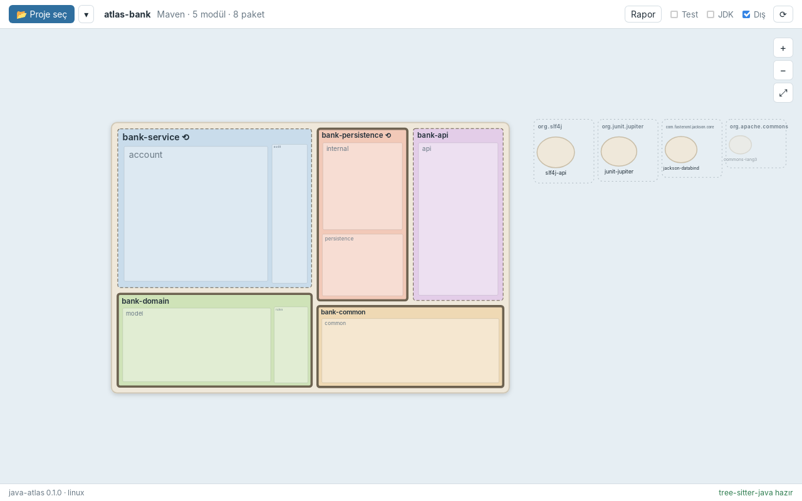
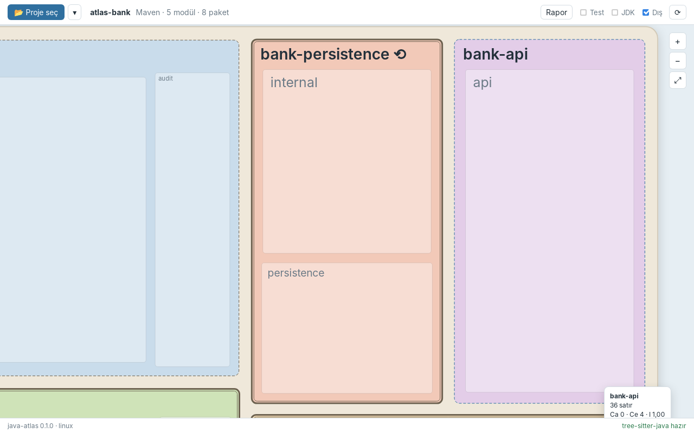
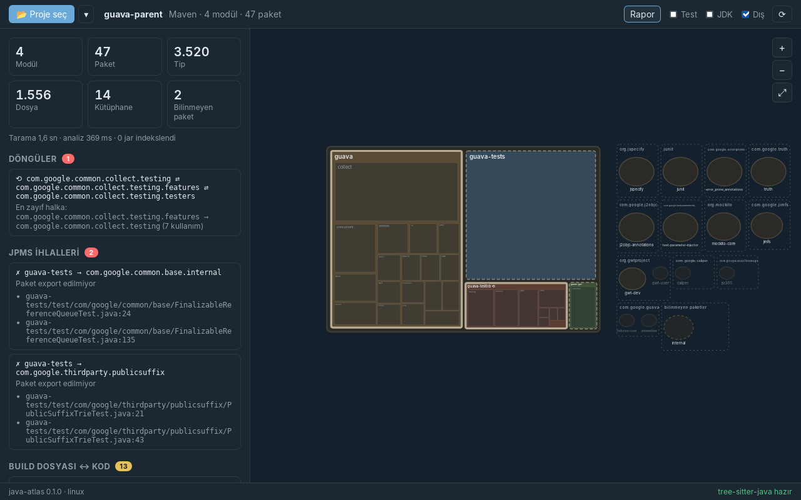

# Faz 5 — Harita Yerleşimi ve İlk Çizim

> **Önceki:** [04 — Tauri köprüsü](04-tauri-kopru.md) · **Sonraki:** 06 — Yollar ve semantik zoom *(yazılacak)*

## 1. Bu bölümde ne yapacağız

Faz 4'teki liste önizlemesinin yerine **haritayı** çiziyoruz:

- **Kara parçası** ortada; **bölgeler** (modüller) karayı kod hacimlerine göre paylaşıyor.
- Her bölgenin içinde **şehirler** (paketler) silik çizgilerle ve adlarıyla görünüyor; test paketleri taralı (şantiye).
- JPMS modüllerinin sınırı **çift çizgi** (gümrük), diğerleri **kesikli** (yumuşak sınır). Döngü içeren bölgelerin adında ⟲.
- **Adalar** (kütüphaneler) doğudaki denizde, aynı groupId'dekiler bir **takımadada**; kullanılmayanlar soluk, bilinmeyen paketler kesikli kıyılı.
- **JDK** filtresi açıksa batıda bir kıyı şeridi ve limanlar (JDK paketleri).
- Tekerlekle imlecin olduğu noktaya **yakınlaşma**, sürükleyerek **kaydırma**, bir bölgeye **çift tıklayınca** o bölgeye yaklaşma, **+ − 0** tuşları, **Rapor** düğmesiyle paneli gizleyip haritaya tüm pencereyi verme.







Yollar (bağımlılıklar) bu fazda **çizilmiyor**: Faz 6'nın konusu. Haritanın önce "coğrafyası" oturmalı.

## 2. Neden böyle

### Tek dünya, tek koordinat sistemi

Yerleşimi her ölçek için ayrı hesaplamak mümkündü: ülke görünümünde modüller bir düzende, bölgeye girince paketler başka bir düzende. Ama o zaman yakınlaşmak bir **sahne değişimi** olurdu; uzaktan gördüğün şehir, yaklaşınca başka bir yerde çıkardı.

Bunun yerine **tüm atlasın tek bir yerleşimi** var, "dünya birimi" denen tek bir koordinat sisteminde:

```
kara (1000 × 680)
 └─ bölge  = karanın treemap'i
     └─ şehir  = bölgenin treemap'i
         └─ bina  = şehrin treemap'i
```

Yakınlaşmak sadece **kamerayı** hareket ettirmek: SVG'nin `viewBox`'ını küçültmek. Uzaktan gördüğün `account` şehri, yaklaşınca tam olarak orada. Faz 6'daki semantik zoom bu sayede sadece "hangi ayrıntıyı çiziyorum" sorusu olacak, "nereye çiziyorum" değil.

### Yerleşim Rust'ta, core'da

| Seçenek | Artı | Eksi |
|---|---|---|
| Ön yüzde (D3 treemap vb.) | Hazır kütüphane | Test zor, her açılışta yeniden hesap, Rust'taki bilgiyle (boyut, ebeveyn) iki kez uğraşmak |
| **Core'da** | Saf fonksiyon, birim testli, deterministik; ön yüz sadece çizer | Algoritmayı kendimiz yazıyoruz — atölyenin amacı zaten bu |

Yerleşim **filtrelerden bağımsız**: test kodunu açıp kapatmak ülkeyi yerinden oynatmamalı. Bu yüzden boyutlar test kodunu da içeriyor; filtre sadece neyin **çizileceğini** belirliyor.

### Neden squarified treemap?

Bir dikdörtgeni alanları verilen değerlerle orantılı parçalara bölmenin en basit yolu **dilimlemek**: hepsini yan yana dikey şeritler. Sonuç: uzun ince şeritler. Okunmaz, etiket sığmaz, tıklanmaz.

*Squarified treemap* (Bruls, Huizing, van Wijk, 2000) parçaları **kareye yakın** tutar. Fikir basit ve açgözlü (greedy):

1. Değerleri büyükten küçüğe sırala.
2. Kalan alanın **kısa kenarı** boyunca bir sıra (row) kur.
3. Sıraya bir öğe daha eklemek, sıradaki **en kötü en-boy oranını** iyileştiriyorsa ekle; kötüleştiriyorsa sırayı kapat, kalan alanda yeni bir sıra başlat.

Makaledeki örnekte (`6 6 4 3 2 2 1`, 6×4'lük alan) dilimleme en küçük öğe için 24:1'lik bir şerit verirken squarify en kötü oranı 3'ün altında tutuyor. Testimiz tam olarak bunu sınıyor.

## 3. Adım adım uygulama

### 3.1 Dosya düzeni

```
crates/java-atlas-core/src/
├── geometry.rs           ← yeni: Rect, squarify
└── atlas/
    └── layout.rs         ← yeni: Atlas::layout() → Layout
src-tauri/src/
├── dto.rs                ← RectDto, OutlineDto, ArchipelagoDto; NodeDto.rect; AtlasViewDto.world/land/mainland/…
└── project.rs            ← OpenProject yerleşimi bir kez hesaplıyor
src/lib/atlas/
├── AtlasView.svelte      ← yeni: harita
├── camera.svelte.ts      ← yeni: viewBox, zoom, pan
└── labels.ts             ← yeni: etiketleri sığdırma
```

`panels/CountryPreview.svelte` silindi; yerini `AtlasView` aldı.

### 3.2 `Rect` ve `squarify` — `geometry.rs`

```rust
#[derive(Debug, Clone, Copy, PartialEq)]
pub struct Rect { pub x: f64, pub y: f64, pub w: f64, pub h: f64 }
```

`inset` (kenar boşluğu), `below_header` (etiket için üst bant), `aspect`, `union`, `contains` gibi küçük yardımcılar var.

Algoritmanın kalbi "en kötü oran" fonksiyonu. Bir sıranın toplam alanı `s`, sıranın dayandığı kenar `w` ise sıradaki bir öğenin en-boy oranı alanıyla ilişkili; en kötüsü ya en büyük ya en küçük öğededir:

```rust
fn worst(row: &[f64], side: f64) -> f64 {
    let sum: f64 = row.iter().sum();
    let (min, max) = row.iter().fold((f64::INFINITY, 0.0f64), |(lo, hi), &a| (lo.min(a), hi.max(a)));
    let s2 = sum * sum;
    let w2 = side * side;
    (w2 * max / s2).max(s2 / (w2 * min))
}
```

Ana döngü:

```rust
pub fn squarify(values: &[f64], rect: Rect) -> Vec<Rect> {
    // … değerleri alana ölçekle, büyükten küçüğe sırala (eşitlikte giriş sırası)
    let mut free = rect;
    let mut row: Vec<(usize, f64)> = Vec::new();
    for item in order {
        let side = free.w.min(free.h);
        // sıraya eklemek en kötü oranı iyileştiriyor mu?
        if row.is_empty() || worst(&with, side) <= worst(&areas, side) {
            row.push(item);
        } else {
            free = place_row(&row, free, &mut out);
            row = vec![item];
        }
    }
    if !row.is_empty() {
        place_row(&row, free, &mut out);
    }
    out
}
```

`place_row` sırayı kalan alanın kısa kenarına yerleştirir (genişse sola bir sütun, uzunsa üste bir satır) ve **kalan** dikdörtgeni döner. Sonuç dizisi **girişin sırasıyla** döner, sıralama sadece içeride; çağıran taraf hangi dikdörtgenin hangi değere ait olduğunu indeksle bilir.

Testler (`geometry::tests`):

- Alanlar değerlerle orantılı, toplamları ana dikdörtgene eşit, hepsi içeride.
- Parçalar çakışmıyor (her çift için kesişim genişliği ya da yüksekliği ≤ 0).
- Makale örneğinde en kötü oran < 3.
- Tek değer her şeyi alır; sıfır değer hiçbir şey almaz; boş giriş boş çıkış.

`f64` sıralamasında `sort_by(|a, b| b.1.total_cmp(&a.1))`: `f64` `Ord` değil (NaN yüzünden), `total_cmp` NaN'ı da sıralayabilen tam bir sıralama verir.

### 3.3 Atlas yerleşimi — `atlas/layout.rs`

```rust
pub struct Layout {
    pub world: Rect,                 // her şey + kenar payı: kameranın "sığdır" dikdörtgeni
    pub land: Rect,
    pub mainland: Rect,              // JDK kıyısı
    pub rects: Vec<Option<Rect>>,    // düğüm başına
    pub archipelagos: Vec<Archipelago>,
}
```

**Kara → bölge → şehir → bina.** Bir yığınla (`Vec` kullanılan bir iş listesi) seviye seviye iniliyor:

```rust
let mut level = vec![(LAND.inset(8.0), modules)];
while let Some((area, ids)) = level.pop() {
    let total = /* çocukların toplam boyutu */;
    let values: Vec<f64> = ids.iter()
        .map(|id| f64::from(sizes[id.index()]).max(total * MIN_SHARE).max(1.0))
        .collect();
    for (id, tile) in ids.iter().zip(squarify(&values, area)) {
        let tile = tile.inset(padding(&tile));            // komşularla arada sınır çizgisi
        rects[id.index()] = Some(tile);
        let inner = tile.inset(padding(&tile)).below_header(header(&tile));   // etiket bandı
        level.push((inner, children[id.index()].clone()));
    }
}
```

Üç ayrıntı:

- **`MIN_SHARE` (%3):** 40 satırlık bir modül, 200.000 satırlık bir modülün yanında görünmez olurdu. Her çocuk en az ebeveyninin %3'ü kadar yer alıyor: tıklanabilir ve adı okunabilir kalıyor. Alanlar artık tam orantılı değil; bilerek verilmiş bir karar.
- **Etiket bandı (`header`):** her parçanın üstünde adı için bir şerit ayrılıyor; çocuklar onun altına yerleşiyor. Yükseklik parçanın boyuyla orantılı (4–28 birim). Ön yüz aynı formülü kullanıyor (`labels.ts → headerOf`), etiket tam o banda oturuyor.
- **Ebeveyn → çocuk tablosu bir kez kuruluyor.** Her parça için tüm düğümleri taramak Guava'da ~3.600 parça × ~3.600 düğüm demek olurdu. Basit bir `Vec<Vec<NodeId>>` ile doğrusal.

**Takımadalar — raf yerleşimi (shelf packing).** Kütüphaneler groupId'ye göre gruplanıyor; en çok kullanılan takımada önce, bilinmeyenler en sonda. Her ada bir daire, yarıçapı kullanım sayısının logaritmasıyla büyüyor (`28 + 6·log2(1+kullanım)`, en fazla 64). Takımadalar denize soldan sağa diziliyor, satır dolunca (640 birim) bir alt rafa geçiliyor.

İlk sürüm takımadaları tek bir sütuna diziyordu. Guava'nın 13 takımadası kara yüksekliğini aşınca dört ayrı sütuna taştı ve dünya o kadar genişledi ki kara ekranda küçücük kaldı. Raf yerleşimiyle deniz alanı karayla aşağı yukarı aynı yükseklikte kalıyor.

**Anakara.** JDK paketleri karanın batısında bir şerit üzerinde alt alta "limanlar". Sadece JDK filtresi açıkken çiziliyor ama yeri her zaman ayrılmış; filtreyi açmak haritayı kaydırmıyor.

Testler (`tests/atlas.rs → layout`):

- Her düğümün bir yeri var ve **ebeveyninin içinde**; modüller karada; ada ve limanlar **asla karada değil**.
- Daha büyük modül daha büyük bölge.
- `atlas-shop-gradle`'da en kalabalık takımada `org.slf4j` (iki ada).
- Yerleşim **deterministik**: aynı proje iki kez → birebir aynı `Layout`.

### 3.4 Görünüme yer bilgisi

`NodeDto`'ya `rect`, `AtlasViewDto`'ya `world`, `land`, `mainland`, `archipelagos` ve `outlines` eklendi. `outlines`, üyelerin çocuklarının silik çizimi için: ülke ölçeğinde şehirler, bölge ölçeğinde binalar. Bunlar **doku**, etkileşim değil; bu yüzden tam `NodeDto` yerine hafif bir `OutlineDto` (anahtar, ebeveyn, dikdörtgen, test mi, tip türü).

`OpenProject` yerleşimi proje açılırken **bir kez** hesaplıyor; görünüm istekleri sadece okuyor.

### 3.5 Kamera — `camera.svelte.ts`

```ts
export class Camera {
  box = $state<Box>({ x: 0, y: 0, w: 1000, h: 700 });

  fit(r: RectDto, margin = 0.04) { /* viewBox = r + kenar payı */ }

  zoomAt(p: { x: number; y: number }, factor: number) {
    const w = clamp(this.box.w * factor);
    const f = w / this.box.w;
    this.box = {
      x: p.x - (p.x - this.box.x) * f,
      y: p.y - (p.y - this.box.y) * f,
      w,
      h: this.box.h * f,
    };
  }

  panBy(dx: number, dy: number) { /* dünya birimiyle kaydır */ }
}
```

`zoomAt`'teki formül "imlecin altındaki dünya noktası yerinde kalsın" demek: `p` noktası ile kutunun sol üst köşesi arasındaki mesafe `f` oranında küçülüyor/büyüyor.

İmleç konumunu dünya koordinatına çevirmek için SVG'nin **ekran dönüşüm matrisi** (CTM):

```ts
function toWorld(clientX: number, clientY: number) {
  const ctm = svg.getScreenCTM();
  const p = new DOMPoint(clientX, clientY).matrixTransform(ctm.inverse());
  return { x: p.x, y: p.y };
}
```

`preserveAspectRatio="xMidYMid meet"` pencere ile `viewBox`'ın en-boy oranı farklıyken içeriği ortalar; CTM bu ortalamayı da içerdiği için hesap her durumda doğru. Sürüklemede piksel → dünya birimi dönüşümü yine CTM'den: `ctm.a` ölçek katsayısı.

Tekerlek: `Math.exp(deltaY * 0.0015)`. Fare tekerleği az sayıda büyük, trackpad çok sayıda küçük `deltaY` gönderir; üstel fonksiyon ikisini de yumuşak bir yakınlaşmaya çevirir.

### 3.6 Çizim — `AtlasView.svelte`

Katman sırası (SVG'de sonra çizilen üstte kalır):

1. **Deniz** — dünyanın 9 katı bir dikdörtgen; kaydırınca kenar görünmesin.
2. **Anakara** ve limanlar (JDK filtresi açıksa).
3. **Kara** — yumuşak bir gölge filtresiyle (`feDropShadow`).
4. **Bölgeler** — dolgu, şehir siluetleri ve adları, sınır, bölge adı.
5. **Takımadalar** ve **adalar**.

**Bölge renkleri.** 8 renklik pastel bir "siyasi harita" paleti, açık ve koyu tema için ayrı (`--region-0` … `--region-7` CSS değişkenleri). Renk, modülün sırasına göre veriliyor; aynı proje her açılışta aynı renklerle.

**Gümrüklü sınır.** JPMS modüllerinde iki dikdörtgen: dışta kalın, içte ince çizgi. JPMS'siz modüllerde 1 piksellik kesikli çizgi. Bir bakışta "bu modül sınırlarını tanımlamış mı?" sorusunun cevabı.

**Çizgiler her yakınlıkta aynı kalınlıkta:**

```css
svg :global(rect), svg :global(ellipse), svg :global(line) { vector-effect: non-scaling-stroke; }
```

Bu olmadan uzaklaşınca sınırlar kaybolur, yaklaşınca kalın kalın şeritlere dönüşür.

**Etiketler dünya biriminde.** Yazı boyutu da haritayla ölçekleniyor: bir bölgeye sığan etiket her yakınlıkta sığıyor. `fitLabel` metni genişliğe sığdıran en büyük yazı boyutunu buluyor; o da bir alt sınırın altına düşüyorsa metni kısaltıyor (`…`). Yazının arkasında okunurluk için bölge renginde bir hale var (`paint-order: stroke`).

**Çift tıklama.** İlk sürüm `ondblclick` kullanıyordu ve WebKitGTK'da hiç çalışmadı. İki neden:

1. Sürükleme için `pointerdown`'da `setPointerCapture` yapılıyordu. Yakalama, sonraki tıklama olaylarını `<svg>`'ye yönlendiriyor; `<g>`'deki işleyici hiç tetiklenmiyor. Çözüm: yakalamayı **imleç 4 pikselden fazla hareket edince** başlatmak. Böylece sadece gerçek sürüklemeler yakalanıyor.
2. Bu düzeltmeden sonra bile `dblclick` olayı SVG grubuna güvenilir biçimde gelmedi. Çift tıklamayı kendimiz algılıyoruz: aynı bölgeye 400 ms içinde ikinci tıklama.

**Erişilebilirlik.** Bölgeler `role="button"` ve `tabindex="0"`: Tab ile dolaşılabiliyor, Enter yaklaştırıyor, odaklanan bölge hover gibi bilgi kutusunu gösteriyor. Harita `role="application"`: ekran okuyucuya "burada kendi klavye kısayollarım var" diyor (+ − 0).

## 4. Takıldığın yerler

| Belirti | Neden | Çözüm |
|---|---|---|
| Çift tıklama çalışmıyor | `pointerdown`'da pointer capture → olaylar `<svg>`'ye gidiyor; ayrıca `dblclick` WebKitGTK'da SVG grubuna gelmiyor | Yakalamayı sürükleme eşiğinden sonra başlat; çift tıklamayı zaman damgasıyla kendin algıla |
| Çift tıklayınca metin seçiliyor | SVG metinleri seçilebilir | `user-select: none` |
| Bilgi kutusu yanlış bölgeyi gösteriyor | Hızlı harekette `pointerenter` kaçabiliyor | `pointerover` |
| Bilgi kutusu imleçten uzakta | SVG alt öğelerinde `offsetX` tutarsız | Konumu `clientX - container.getBoundingClientRect().left` ile hesapla |
| Uzaklaşınca sınırlar kayboluyor | Çizgi kalınlığı da ölçekleniyor | `vector-effect: non-scaling-stroke` |
| Guava'da kara ekranda çok küçük | Takımadalar tek sütunda dört sütuna taşmış | Raf yerleşimi (shelf packing) |
| Küçük modüller görünmüyor | Alan tamamen orantılı | `MIN_SHARE` ile taban pay |
| `f64` vektörü sıralanmıyor | `f64: Ord` değil | `total_cmp` |
| `{@const}` derleme hatası | Svelte 5'te `{@const}` sadece blokların doğrudan çocuğu olabilir | `{#each}` / `{#if}` bloğunun hemen başına taşı |

## 5. Ne öğrendik

- **Squarified treemap:** açgözlü sıra kurma, en kötü en-boy oranı, kalan alanda devam.
- Hiyerarşik bir yerleşimi **tek koordinat sisteminde** kurmanın, yakınlaşmayı "kamera hareketi"ne indirgemesi.
- Yerleşimi **filtrelerden ve ölçekten bağımsız** tutmak; deterministik çıktı ve snapshot'a uygun yapı.
- Raf yerleşimi (shelf packing) ile değişken boyutlu grupları bir alana dizmek.
- SVG `viewBox` ile kamera; **CTM** ile ekran ↔ dünya dönüşümü; imleç merkezli zoom formülü.
- `vector-effect: non-scaling-stroke`, `paint-order: stroke`, `feDropShadow`, `pattern` ile tarama.
- Pointer capture'ın tıklama olaylarını nasıl etkilediği ve sürükleme eşiği.
- SVG'de klavye ve ekran okuyucu erişilebilirliği.

## 6. Kendin dene

1. **Alt paketler mahalle olsun:** Şu an `com.atlasbank.service.account` ve `com.atlasbank.service.audit` aynı seviyede iki şehir. PLAN'da alt paketlerin üst paketin içinde mahalle olarak yuvalanması öneriliyordu. `layout`'ta paketleri ortak öneklerine göre bir ağaca dönüştürüp iç içe treemap kur. Hangi projelerde okunurluk artıyor, hangilerinde azalıyor?
2. **Organik kıyılar:** Kara parçasının dikdörtgen kenarlarını bir SVG `feTurbulence` + `feDisplacementMap` filtresiyle hafifçe dalgalandır. Yerleşim değişmez, sadece görünüm. Yazıları etkilemeden yapmanın yolu ne? (İpucu: filtreyi sadece kara dikdörtgenine uygula.)
3. **Mini harita:** Sağ alt köşede tüm dünyanın küçük bir kopyasını ve kameranın o anki çerçevesini gösteren bir mini harita ekle. Mini haritaya tıklayınca kamera oraya gitsin. `camera.box` zaten elinde.
