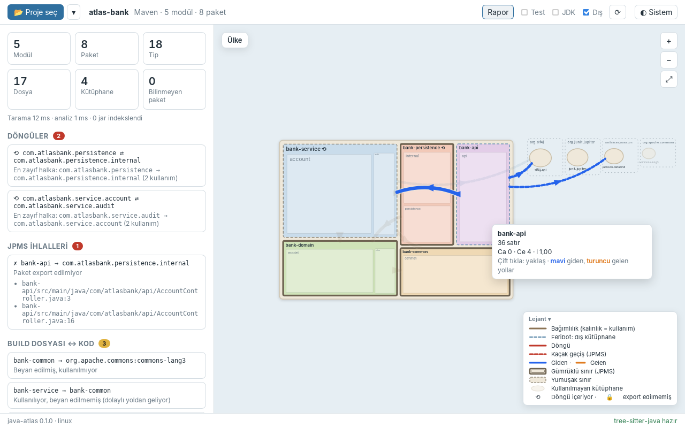
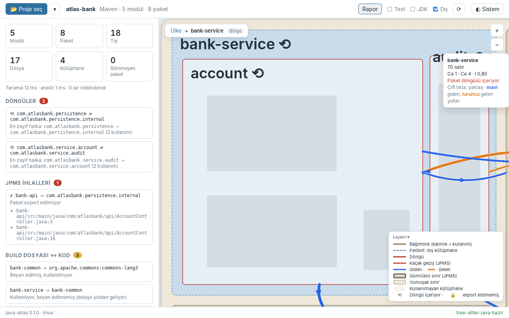
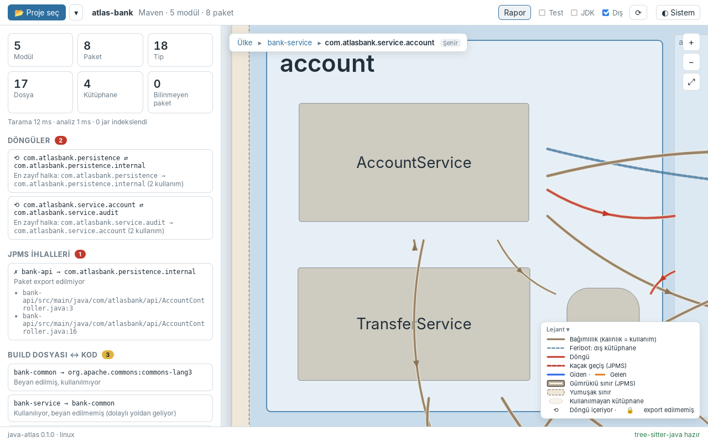
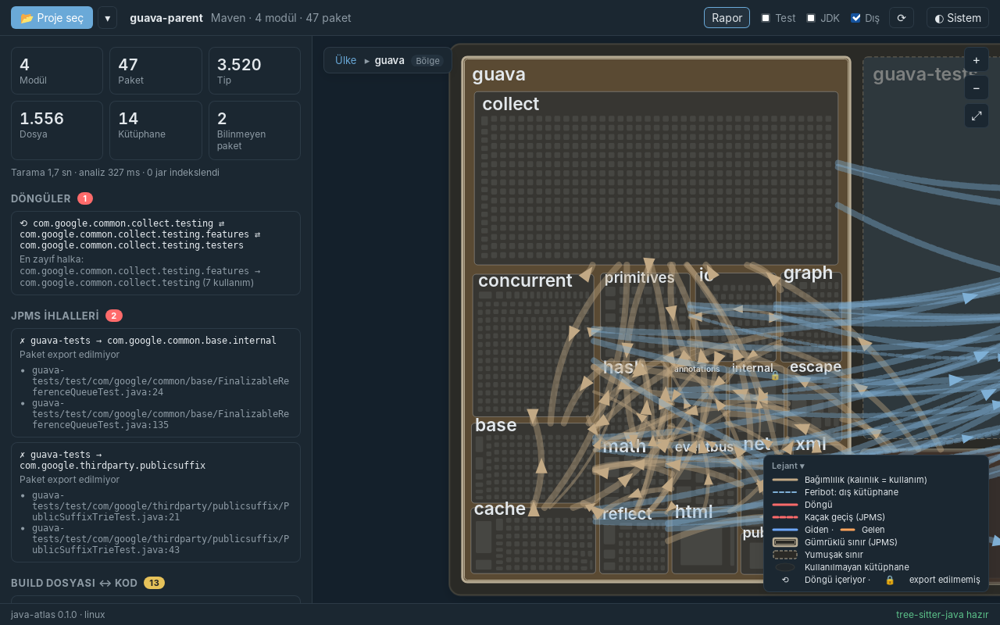

# Faz 6 — Yollar ve Semantik Zoom

> **Önceki:** [05 — Harita yerleşimi ve ilk çizim](05-treemap-ve-cizim.md) · **Sonraki:** [07 — Etkileşim ve bilgi panelleri](07-etkilesim-ve-paneller.md)

## 1. Bu bölümde ne yapacağız

Faz 5'te haritanın coğrafyası oturdu. Şimdi üzerine **yolları** çiziyor ve **üç ölçeği** birbirine bağlıyoruz:

- **Yollar:** bölgeler/şehirler/binalar arası bağımlılıklar; kalınlık kullanım sayısının logaritması, ortada yön oku.
- **Feribot hatları:** adalara (kütüphanelere) kesikli mavi çizgiler; JDK limanlarına noktalı kıyı yolları.
- **Döngü** yolları kırmızı, **kaçak geçiş** (JPMS ihlali) kırmızı kesikli; yalnızca testte kullanılan yollar soluk.
- Bir bölgenin/şehrin/binanın üzerine gelince **giden yollar mavi, gelenler turuncu**, diğerleri soluklaşır. Bir yolun üzerine gelince "A → B · n kullanım".
- **Semantik zoom:** Ülke ▸ Bölge ▸ Şehir.
  - Çift tıklama ya da Enter: o bölgeye/şehre **uçarak** yaklaşma.
  - Fare tekerleği: bir bölge görüşü yeterince doldurunca ölçek kendiliğinden değişir; yeterince uzaklaşınca bir üst ölçeğe döner.
  - **Ekmek kırıntısı** ile ya da **Esc** ile geri.
- **Lejant** ve **tema düğmesi** (Sistem / Açık / Koyu).









## 2. Neden böyle

### Taban harita + o anki ölçek

Ön yüz artık iki görünüm tutuyor:

| Görünüm | Ne zaman | Ne çizer |
|---|---|---|
| **Taban** (ülke) | Her zaman | Kara, tüm bölgeler, tüm adalar, şehir siluetleri |
| **O anki ölçek** | Bölge ya da şehir ölçeğinde | Odaktaki bölgenin şehirleri / odaktaki şehrin binaları, ve **yollar** |

Bölge ölçeğinde diğer bölgeler kaybolmuyor, soluklaşıyor: komşuluk bilgisi kaybolmamalı. Adalar hep tabandan geliyor; bu yüzden ölçek değişince yerlerinden oynamıyorlar, sadece odakla bağlantısı olmayanlar soluklaşıyor.

Faz 5'teki "tek dünya" kararının karşılığı burada: ölçek değiştirmek **çizimi yeniden yerleştirmek değil**, sadece hangi katmanın ayrıntılı çizileceğini seçmek. Kamera zaten oradayken yeni ölçeğin verisi aynı koordinatlara oturuyor.

### Yollar sınırdan çıkar, sağdan gider

Bir yol iki merkezi düz bir çizgiyle birleştirseydi:

1. Bütün yollar bölge merkezlerinde düğümlenirdi.
2. A → B ve B → A **aynı çizgi** olurdu; bir döngü haritada görünmezdi.

Bu yüzden:

- Yol, kaynağın **sınırından** çıkar, hedefin **sınırında** biter (dikdörtgen ya da elips kesişimi).
- Yol hafifçe bükülür ve büküm **her zaman gidiş yönünün sağına**dır. A → B ve B → A iki ayrı şerit olur; iki şehir arasındaki döngü haritada küçük bir göz gibi görünür (bölge ölçeği görüntüsünde `account` ↔ `audit`).

### Kalınlık: logaritmik

Guava'da `guava-testlib → junit` yolu 335 kullanım, bazı yollar 1. Doğrusal bir ölçek ya tek kalın bir şerit ve görünmez çizgiler ya da hepsi aynı kalınlık demek. `1 + 1.6 · log2(1 + n)` (en fazla 8 piksel): 1 kullanım ≈ 2.6 px, 10 ≈ 6.5 px, 100+ ≈ 8 px.

### Semantik zoom ve histerezis

"Yeterince yaklaşınca bölgeye gir, yeterince uzaklaşınca çık" kuralı tek bir eşikle yazılırsa, kullanıcı tam eşiğin üzerinde tekerleği oynatınca ölçek ileri geri **titrer**. İki farklı eşik kullanıyoruz (histerezis):

| Geçiş | Koşul |
|---|---|
| İçeri | Görüş merkezindeki bölge/şehir, görüş genişliğinin **%55'inden** genişse |
| Dışarı | Görüş, odaktaki bölge/şehrin **2,6 katından** genişse |

İki eşik arasında ölçek sabit kalır. Kontrol, tekerlek **durduktan 220 ms sonra** yapılır; kaydırma sürerken ölçek değişmez.

## 3. Adım adım uygulama

### 3.1 Dosya düzeni

```
src-tauri/src/project.rs           ← same_cycle: tip seviyesinde döngü işareti; dump_fixtures
src/lib/project.svelte.ts          ← crumbs, scale, focus, enter/goTo/up, view (o anki ölçek)
src/lib/atlas/
├── AtlasView.svelte               ← yollar, şehirler, binalar, semantik zoom
├── camera.svelte.ts               ← flyTo, land
├── roads.ts                       ← yeni: yol geometrisi
├── Breadcrumb.svelte              ← yeni
└── Legend.svelte                  ← yeni
src/lib/theme.ts                   ← yeni: tema seçimi
scripts/ui-check.mjs               ← yeni: tarayıcıda sahte Tauri köprüsüyle UI denemesi
```

### 3.2 Döngü işareti tip seviyesinde — `project.rs`

Faz 4'te bir yol, iki ucu **aynı döngüdeki paketler** ise kırmızıydı. Şehir ölçeğinde uçlar tip (bina) ya da paket olabiliyor. Artık her düğümün döngüsü, paket atasının döngüsü:

```rust
fn same_cycle(&self, from: NodeId, to: NodeId) -> bool {
    matches!((self.cycle_of_node(from), self.cycle_of_node(to)), (Some(a), Some(b)) if a == b)
        && package(from) != package(to)
}
```

İkinci koşul önemli: `AuditLog → AuditEntry` aynı paketin içinde kalıyor; paket döngüde olsa da bu yol döngünün parçası **değil**. Test: `city_view_marks_type_roads_inside_a_cycle`.

### 3.3 Yol geometrisi — `roads.ts`

```ts
export function exitPoint(r: RectDto, shape: Shape, to: Point): Point {
  const c = centre(r);
  const dx = to.x - c.x;
  const dy = to.y - c.y;
  let t: number;
  if (shape === "ellipse") {
    t = 1 / Math.sqrt((dx / rx) ** 2 + (dy / ry) ** 2);   // (t·dx/rx)² + (t·dy/ry)² = 1
  } else {
    t = Math.min(rx / Math.abs(dx), ry / Math.abs(dy));    // ışının ilk çarptığı kenar
  }
  return { x: c.x + dx * t, y: c.y + dy * t };
}

export function road(a, aShape, b, bShape, bend = 0.18): Road {
  const s = exitPoint(a, aShape, centre(b));
  const e = exitPoint(b, bShape, centre(a));
  // s → e'nin sağına bakan normal (SVG'de y aşağı doğru büyür)
  const nx = -dy / length;
  const ny = dx / length;
  const c = { x: midX + nx * length * bend, y: midY + ny * length * bend };
  // İkinci derece Bézier, t = 0.5: ¼·s + ½·c + ¼·e; teğeti e − s
  const mid = { x: 0.25 * s.x + 0.5 * c.x + 0.25 * e.x, y: … };
  return { d: `M ${s.x} ${s.y} Q ${c.x} ${c.y} ${e.x} ${e.y}`, mid, angle: Math.atan2(dy, dx) };
}
```

**Ok başı ayrı bir `path`.** easy-git'te öğrendiğimiz ders: SVG `<marker>` ile ok başını yolun rengine boyamak için gereken `context-stroke` WebKitGTK'da yok. Burada üstelik ok başlarının **ekranda** sabit boyutta kalması gerekiyor; çizgiler `vector-effect: non-scaling-stroke` ile sabit ama ok başı bir alan, çizgi değil. Çözüm: ok başını her çizimde dünya biriminde hesaplamak:

```ts
/** Ekran pikseli başına dünya birimi ("meet" kutuyu elemanın içine sığdırır). */
const unit = $derived(Math.max(camera.box.w / width, camera.box.h / height));
// …
<path class="arrow" d={arrowHead(r.geometry.mid, r.geometry.angle, (6 + r.width) * unit)} />
```

`width` ve `height` kapsayıcının `bind:clientWidth` / `bind:clientHeight` değerleri; kamera ya da pencere değişince `unit` yeniden hesaplanır, ok başları hep ~6–14 piksel kalır.

**Tıklama alanı.** 1,5 piksellik bir çizginin üzerine gelmek zor. Her yolun üstünde 12 piksel kalınlığında **görünmez** bir kopya var (`stroke: transparent; pointer-events: stroke`); bilgi kutusu onunla tetikleniyor.

### 3.4 Kamera uçuşu — `camera.svelte.ts`

```ts
flyTo(r: RectDto, ms = 450) {
  const from = { ...this.box };
  this.fit(r);
  const to = { ...this.box };
  // …
  const step = (now: number) => {
    const t = ease(Math.min(1, (now - started) / ms));
    const w = from.w * (to.w / from.w) ** t;     // boyut: geometrik
    const cx = fromCx + (toCx - fromCx) * t;     // konum: doğrusal
    // …
    if (t < 1) requestAnimationFrame(step);
  };
}
```

Boyutun **geometrik** ara değerlenmesi önemli: 1000 birimden 100'e doğrusal geçişte zoom sonda çok hızlı olur. `w = w0 · (w1/w0)^t` ile her eşit zaman diliminde genişlik **aynı oranda** küçülür; harita üzerinde alçalırken hissedilen budur.

- Kullanıcı uçuş sırasında tekerleği çevirir ya da sürüklerse uçuş **iptal** edilir (`land()` bir sayaç artırır; eski uçuşun adımları kendi kimliği güncel değilse durur).
- `prefers-reduced-motion: reduce` ise uçuş yok, doğrudan yeni konum.

### 3.5 Ölçek durumu — `project.svelte.ts`

```ts
export interface Crumb {
  scale: ScaleDto;          // "country" | "region" | "city"
  key: string | null;       // odaktaki modül ya da paket
  name: string;
  rect: RectDto | null;     // geri dönerken uçulacak yer
}

class ProjectStore {
  country = $state<AtlasViewDto | null>(null);   // taban harita
  view = $state<AtlasViewDto | null>(null);      // o anki ölçek
  crumbs = $state<Crumb[]>([COUNTRY]);

  get scale() { return this.crumbs[this.crumbs.length - 1].scale; }

  async enter(node: NodeDto) { /* modül → bölge, paket → şehir; kırıntıyı yeniden kur */ }
  async goTo(index: number) { /* kırıntıyı kes, görünümü yükle */ }
}
```

- Ülke ölçeğinden **doğrudan** bir şehre girilirse (otomatik zoom bunu yapabilir), aradaki bölge kırıntısı eklenir: geri dönüş yolu hep Ülke ▸ Bölge ▸ Şehir.
- Yeniden taramadan sonra odaktaki modül/paket artık yoksa (`unknownNode` hatası), sessizce ülke ölçeğine dönülür.

### 3.6 Çizim katmanları — `AtlasView.svelte`

1. Deniz, anakara, kara
2. **Bölgeler** (taban): odak dışındakiler `.context` → %45 opaklık. Ülke ve şehir ölçeğinde şehir siluetleri tabandan.
3. **Şehirler** (bölge ölçeği): etkileşimli kutular; içlerinde binaların siluetleri; döngüdeki şehrin kenarı kırmızı; JPMS modülünün export etmediği şehirde 🔒.
4. **Binalar** (şehir ölçeği): türe göre biçim — sınıf: kutu, arayüz: kesikli kenarlı açık kutu, enum: altıgen, record: yuvarlatılmış kutu, annotation: üçgen; test binaları taralı.
5. **Takımadalar ve adalar** (taban)
6. **Yollar** — en üstte; bağladıkları her şeyin üzerinde.

Kalabalık görünümlerde (60'tan fazla yol, ör. Guava'nın `guava` bölgesi) yollar `.dense` sınıfıyla inceltiliyor ve soluklaşıyor; vurgulanan (mavi/turuncu) yollar tam renkte kalıyor. Gerçek çözüm — kenar demetleme — Faz 9'da.

### 3.7 Klavye

| Tuş | Etki |
|---|---|
| `+` / `−` | Yakınlaş / uzaklaş (bitince ölçek kontrolü) |
| `0` | Tüm ülke |
| `Esc` | Bir üst ölçek |
| `Tab` / `Enter` | Bölgeler / şehirler arasında gez, odaktakine gir |

Bir tıklama ya da Enter ile şehre girildiğinde, odakta olan şehir kutusu yeni ölçekte artık yok; tarayıcı odağı `body`'ye bırakır ve Esc kimseye ulaşmaz. İki önlem: girişten sonra `svg.focus()`, ve `<svelte:window onkeydown>` ile Esc/0'ı odak nerede olursa olsun yakalamak (bir metin kutusuna yazılmıyorsa).

### 3.8 Tema — `theme.ts`

Üç seçenek: **Sistem** (`prefers-color-scheme`), **Açık**, **Koyu**. Seçim `<html data-theme="…">` özniteliğiyle uygulanıyor:

```css
@media (prefers-color-scheme: dark) {
  :root:not([data-theme="light"]) { /* koyu renkler */ }
}
:root[data-theme="dark"] { color-scheme: dark; /* koyu renkler */ }
:root[data-theme="light"] { color-scheme: light; }
```

İlk blok "sistem koyu istiyor ve kullanıcı açığı seçmedi", ikincisi "kullanıcı koyuyu seçti". Seçim `localStorage`'da (`try/catch` ile; kaybolursa sadece "Sistem"e döner). `main.ts` temayı **ilk boyamadan önce** uyguluyor, koyu temada beyaz bir an parlamasın diye.

### 3.9 Tarayıcıda UI denemesi — `scripts/ui-check.mjs`

Bu fazda haritayla çok uğraştık ve her denemede masaüstü uygulamasını derleyip çalıştırmak yavaştı. Ön yüz Tauri ile sadece `window.__TAURI_INTERNALS__.invoke` üzerinden konuşuyor; bu nesneyi sahtesiyle değiştirirsek uygulama sıradan bir tarayıcıda çalışır.

1. Rust tarafı, `atlas-bank` için IPC cevaplarını JSON olarak yazar (yok sayılan bir test):

   ```bash
   FIXTURE_DIR=$PWD/target/ui-fixtures cargo test -p java-atlas dump_fixtures -- --ignored
   ```

2. Playwright betiği Chromium açar, sayfa yüklenmeden **önce** sahte köprüyü enjekte eder (`page.addInitScript`), adım adım fare/klavye hareketleri yapar ve ekran görüntüsü alır:

   ```bash
   npm install --no-save playwright@1.56.1 && npx playwright install chromium   # bir kez
   VITE_AUTO_OPEN=demo npm run dev                                              # ayrı terminal
   node scripts/ui-check.mjs target/ui/shot "move:900:400,shot:hover,dbl:600:330,wait:900,shot:region"
   ```

Sahte köprü `transformCallback`'i de sağlıyor, çünkü `Channel` nesnesi kurulurken çağrılıyor. Konsol hataları ve sayfa hataları terminale düşüyor. Bu fazdaki Playwright denemelerinin tamamı bu düzenekle yapıldı; son ekran görüntüleri ise gerçek uygulamadan alındı.

## 4. Takıldığın yerler

| Belirti | Neden | Çözüm |
|---|---|---|
| A → B ile B → A tek çizgi; döngü görünmüyor | Düz ya da simetrik bükülen yollar | Bükümü gidiş yönünün **sağına** ver |
| Ok başları uzaklaşınca kayboluyor, yaklaşınca dev | Ok başı dünya biriminde sabit | Boyutu `unit` (piksel başına dünya birimi) ile çarp |
| Ok başı siyah | `<marker>` + `context-stroke` WebKitGTK'da yok | Ok başını ayrı `path` olarak çiz |
| Yola fareyle gelmek zor | Çizgi 1–2 piksel | Üstüne 12 px kalınlığında görünmez bir "hit" yolu |
| Ölçek tekerlekle ileri geri titriyor | Tek eşik | İki eşik (%55 içeri, 2,6× dışarı) + 220 ms bekleme |
| Uçuşun sonunda zoom aniden hızlanıyor | Boyut doğrusal ara değerlenmiş | Geometrik: `w0 · (w1/w0)^t` |
| Şehre girince Esc çalışmıyor | Odaklı kutu DOM'dan kalktı, odak `body`'de | Girişte `svg.focus()` + `svelte:window` ile Esc |
| Ölçek değişince eski bilgi kutusu ekranda kalıyor | `hovered` hâlâ eski düğüm | `crumbs` değişince `hovered = null` |
| Geliştirme sunucusu yeniden başlarken bir kez bileşen stilleri eksik geldi | Vite'ın ilk derlemesi sırasında WebView'ın erken yüklemesi | Sayfayı yenile; kalıcı değil (iki temiz çalıştırmada tekrarlanmadı) |

## 5. Ne öğrendik

- İkinci derece Bézier ile yol; orta noktası ve teğeti; dikdörtgen/elips kesişimi.
- Ekranda sabit boyutlu ögeleri bir `viewBox` dünyasında çizmek: piksel başına dünya birimi.
- Kamera uçuşu: `requestAnimationFrame`, yumuşatma (easing), boyutun geometrik ara değerlenmesi, iptal edilebilir animasyon, `prefers-reduced-motion`.
- Semantik zoom'da **histerezis** ve "kullanıcı durunca karar ver" (debounce).
- Taban harita + odak katmanı mimarisi; ölçek değişince hiçbir şeyin yerinden oynamaması.
- Odak yönetimi: DOM'dan kalkan öğe ve pencere seviyesinde klavye kısayolları.
- `data-theme` + `prefers-color-scheme` ile üç durumlu tema.
- Bir Tauri ön yüzünü **sahte köprüyle** tarayıcıda sürmek: `__TAURI_INTERNALS__`, Playwright, Rust'tan üretilmiş fikstürler.

## 6. Kendin dene

1. **Yol tıklayınca kanıt:** Bir yola tıklayınca `getEdgeEvidence(from, to)` ile kanıt listesini küçük bir açılır pencerede göster. (Faz 7'deki ayrıntı panelinin parçası olacak.)
2. **Yön okları yerine akış:** Ok başları yerine yol boyunca akan kesikli bir animasyon (`stroke-dashoffset`) dene. Okunurluğu artırıyor mu, yoksa harita yorucu mu oluyor? `prefers-reduced-motion`'ı unutma.
3. **Ölçek geçişi eşikleri:** `ENTER_SHARE` ve `LEAVE_FACTOR` değerleriyle oyna. Çok küçük bir projede (tek modül) ve Guava'da ayrı ayrı dene; tek bir sabit ikisine de uyuyor mu? Uymuyorsa eşiği nasıl uyarlanır yaparsın?
