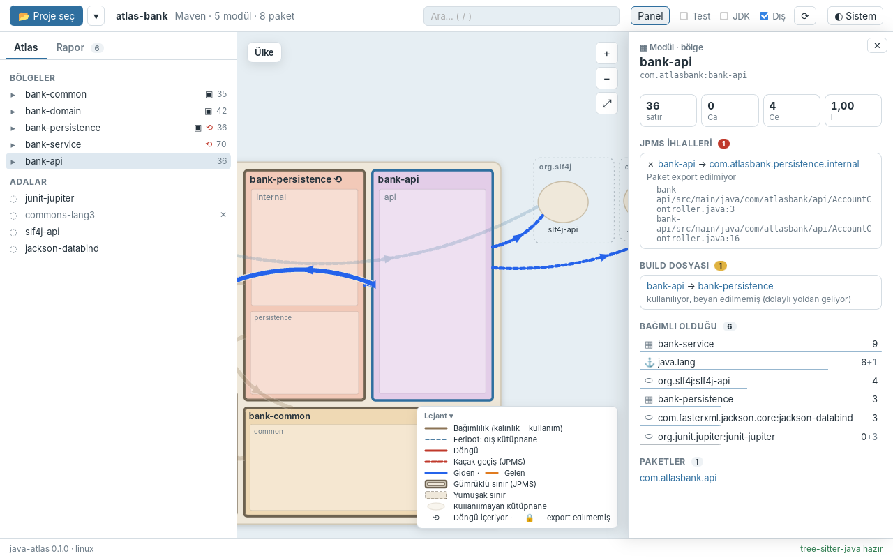
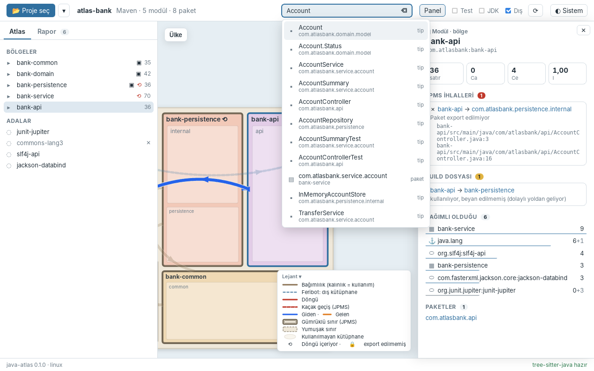

# Faz 7 — Etkileşim ve Bilgi Panelleri

> **Önceki:** [06 — Yollar ve semantik zoom](06-yollar-ve-zoom.md) · **Sonraki:** 08 — Canlı izleme *(yazılacak)*

## 1. Bu bölümde ne yapacağız

Faz 6'nın sonunda harita güzeldi ama "dilsizdi": bir şehrin üzerine gelince birkaç satırlık bilgi kutusu, o kadar. Bu fazda harita **soru cevaplayan** bir araca dönüşüyor ve MVP tamamlanıyor:

- **Detay çekmecesi** (sağda): seçilen modül/paket/tip/kütüphanenin her şeyi — konum (Ülke ▸ bölge ▸ şehir), satır sayısı, Ca / Ce / I, kaynak dosyası (kopyala), `module-info` özeti, içinde bulunduğu döngüler, JPMS ihlalleri, build dosyası bulguları, **bağımlı olduğu** ve **ona bağımlı olan** her şey (ağırlık çubuklarıyla), alt paketler/tipler, bir kütüphanenin hangi paketleri sağladığı (jar ile mi, ad tahminiyle mi).
- **Yol seçimi:** bir yola tıklayınca `A → B`, kullanım sayısı, döngü/ihlal etiketleri ve **kanıt listesi** (`dosya:satır`), tek tek ya da topluca kopyalanabilir.
- **Kenar çubuğu:** *Atlas* sekmesinde modül ▸ paket ağacı ve adalar, rozetleriyle (▣ JPMS, ⟲ döngü, 🔒 export edilmemiş, ✕ kullanılmayan, ! beyan edilmemiş); *Rapor* sekmesi Faz 4'teki rapor, ama artık her adı bir bağlantı.
- **Arama:** araç çubuğunda; `/` ya da Ctrl+F ile odaklanır, yön tuşlarıyla gezilir, Enter haritayı oraya uçurur.
- Haritada **tek tık seçer**, ikinci tık içeri girer; boş denize tık seçimi kaldırır; **Esc** önce seçimi, sonra ölçeği bırakır.





## 2. Neden böyle

### Tek bir "oraya git" fonksiyonu

Haritada bir şeye gitmenin artık beş yolu var: ağaç, arama, rapor, detay panelindeki bağlantılar ve haritanın kendisi. Hepsinin aynı şeyi yapması gerekiyor:

1. Düğümün **hangi ölçekte çizildiğini** bul (modül → ülke, paket → bölge, tip → şehir, ada/liman → ülke).
2. O ölçeğin görünümünü yükle (ekmek kırıntısını kur).
3. Düğümü seç (detay paneli).
4. Kamerayı oraya uçur.

Bunu her bileşende ayrı ayrı yazmak, beş ayrı hata kaynağı demek. Bu yüzden store'da tek bir `goToNode(key)` var; bileşenler sadece anahtar veriyor. Hangi ölçekte olduğunu bulmak için ek bir komut gerekmedi: `get_node_details` artık düğümün **yolunu** (`path`: modül → paket → tip) döndürüyor, ekmek kırıntısı doğrudan ondan kuruluyor.

### Store kamerayı bilmez, kamera da store'u

`goToNode` store'da, kamera ise `AtlasView` içinde. Store'un kameraya doğrudan erişmesi (bir referans tutması) bileşen ömrüne bağımlılık yaratırdı. Bunun yerine store bir **istek** yayımlıyor:

```ts
fly(rect, margin) { this.flight = { rect, margin, seq: ++this.flightSeq }; }
```

`AtlasView` bu alanı bir `$effect` ile izliyor. `seq` sayacı, aynı yere ikinci kez gitme isteğinin de (aynı dikdörtgen) bir değişiklik sayılmasını sağlıyor.

### Detay paneli neden haritanın üstünde yüzüyor?

Plan, paneli ekranın altına koyuyordu; ilk denemede onu sağda ayrı bir ızgara sütunu yaptım. İkisi de aynı hataya düşüyor: **panel açılınca harita daralıyor**. `viewBox` + `preserveAspectRatio="meet"` haritayı yeni boyuta sığdırıyor, yani her şey biraz kayıyor. Bunun somut bir sonucu var: çift tıklamanın ilk tıkı seçim yapıp paneli açıyor, harita kayıyor, ikinci tık **başka bir şehre** düşüyor. Playwright denemesinde `account` şehrine çift tıklayınca `audit` seçildi.

Çözüm, paneli haritanın üstüne bindirmek. Harita hiç kımıldamıyor; karşılığında sağ tarafının bir kısmı örtülüyor. Bu yüzden kamera uçuşları örtülen kısmı biliyor: hedef, panelin **bıraktığı** alanın ortasına yerleşiyor (§3.4).

### Tek tık mı, çift tık mı?

Faz 6'da tek tık hiçbir şey yapmıyordu, çift tık içeri giriyordu. Şimdi tek tık **seçiyor** ve ikinci tık hâlâ içeri giriyor. İkisi çakışmıyor çünkü içeri girmek seçimi bozmuyor: girdiğin şehrin detayları zaten açık. Binalar, adalar ve limanlar "girilebilir" değil; onlarda tık sadece seçer.

### Arama neden Rust tarafında?

Ön yüze bütün düğüm adlarını gönderip orada süzmek küçük projelerde daha hızlı hissettirir, ama Guava'da on binlerce tip demek. Core'a bir `Atlas::search` eklemek hem sıralama kuralını test edilebilir yaptı hem IPC yükünü 30 sonuçla sınırladı.

Sıralama: **tam ad > önek > içerir > tam adın (FQN) içinde**; aynı derecede önce daha geniş şey (modül, paket, tip…), sonra kısa ad. "Account" yazınca `Account` tipi `AccountService`'ten, o da `InMemoryAccountStore`'dan önce geliyor.

## 3. Adım adım uygulama

### 3.1 Rust: detay, ağaç, arama

`NodeDetailsDto`'ya panelin tek istekle dolması için beş alan eklendi: `path`, `jpms`, `cycles`, `violations`, `findings`. Döngü/ihlal/bulgu zaten özet raporda vardı; detay bunları düğüme göre süzüyor:

```rust
// src-tauri/src/project.rs (özet)
let cycles = s.cycles.iter()
    .filter(|c| c.packages.iter().any(|p| {
        // a package in the cycle, or a module containing one
        p.key == key || self.parent_key(&p.key).as_deref() == Some(key.as_str())
    }))
    .cloned()
    .collect();
```

İki yeni komut:

```rust
#[tauri::command]
pub async fn get_tree(state: State<'_, AppState>) -> Result<TreeDto, AppError> { … }

#[tauri::command]
pub async fn search(query: String, state: State<'_, AppState>) -> Result<Vec<SearchHitDto>, AppError> { … }
```

`SearchHitDto { node, context }` — `context` sonucun nerede yaşadığı (tipin paketi, paketin modülü), açılır listede ikinci satır.

Core'daki arama (`crates/java-atlas-core/src/atlas/search.rs`), sıralamayı bir **tuple** ile yapıyor; Rust tuple'ları alan alan karşılaştırdığı için ayrı bir karşılaştırıcı gerekmiyor:

```rust
let mut hits: Vec<(u8, u8, usize, &str, NodeId)> = self.nodes.iter()
    .filter_map(|n| {
        let name = n.name.to_lowercase();
        let rank = if name == q { 0 }
            else if name.starts_with(&q) { 1 }
            else if name.contains(&q) { 2 }
            else if n.fqn.to_lowercase().contains(&q) { 3 }
            else { return None };
        Some((rank, kind_order(&n.kind), n.name.len(), n.name.as_str(), n.id))
    })
    .collect();
hits.sort();
```

### 3.2 Store: seçim ve `goToNode`

```ts
// src/lib/project.svelte.ts
export type Selection =
  | { kind: "node"; details: NodeDetailsDto }
  | { kind: "road"; edge: ViewEdgeDto; from: NodeDto; to: NodeDto; evidence: EvidenceDto[] };

async goToNode(key: string) {
  const details = await api.getNodeDetails(key);
  const node = details.node;
  const [module, pkg] = details.path;
  let target = node.rect;
  let margin = 0.04;
  switch (node.kind) {
    case "module":  this.crumbs = [COUNTRY]; margin = 0.6; break;                 // region + neighbours
    case "package": this.crumbs = [COUNTRY, crumbOf(module)]; margin = 0.6; break;
    case "type":    this.crumbs = [COUNTRY, crumbOf(module), crumbOf(pkg)]; target = pkg.rect; break;
    default:        // islands and ports live in the base map; ports need the JDK filter
      if (node.kind === "jdk" && !this.filters.jdk) this.filters = { ...this.filters, jdk: true };
      this.crumbs = [COUNTRY];
      margin = 3;
  }
  await this.refreshView();
  this.selection = { kind: "node", details };
  this.fly(target, margin);
}
```

Bir tipe giderken kamera **binaya değil şehre** uçuyor: tek bir binayı ekranı dolduracak kadar büyütmek bağlamı kaybettiriyor; bina şehrin içinde vurgulu duruyor.

TypeScript'in **ayrımlı birleşim** (discriminated union) tipi `Selection` için biçilmiş kaftan: `sel.kind === "road"` dediğin anda `sel.evidence`'a erişebiliyorsun, `sel.details`'e erişemiyorsun.

### 3.3 Uygulama düzeni

```svelte
<!-- src/App.svelte -->
<div class="workspace" class:with-side={project.showSide}>
  {#if project.showSide}<SidePanel />{/if}
  <div class="map-area">
    {#if project.country}<AtlasView />{/if}
    {#if project.selection}
      <div class="drawer"><DetailsPanel /></div>
    {/if}
  </div>
</div>
```

```css
.map-area { position: relative; min-width: 0; min-height: 0; }
.drawer { position: absolute; top: 0; right: 0; bottom: 0; width: min(380px, 45%); }
```

`min-width: 0` unutulursa uzun bir dosya yolu ızgara sütununu genişletir ve harita sağdan taşar: ızgara öğelerinin varsayılan `min-width`'i `auto`'dur, yani içeriğin en geniş kelimesi.

### 3.4 Kamera: örtülen alanı hesaba katmak

`Camera.fit` artık isteğe bağlı bir `Viewport { width, height, covered }` alıyor. Hedefin piksel başına ölçeğini **görünür** genişliğe göre hesaplayıp kutuyu öğenin kendi en-boy oranıyla kuruyor; böylece `meet` hiçbir şeyi yeniden ortalamıyor ve hedef görünür kısmın ortasında kalıyor:

```ts
fit(r: RectDto, margin = 0.04, view?: Viewport) {
  const w = r.w * (1 + 2 * margin);
  const h = r.h * (1 + 2 * margin);
  const visible = view ? view.width - view.covered : 0;
  if (!view || visible <= 0 || view.height <= 0) { /* eski davranış */ }
  const perPixel = Math.max(w / visible, h / view.height);
  const cx = r.x + r.w / 2, cy = r.y + r.h / 2;
  this.box = {
    x: cx - (perPixel * visible) / 2,
    y: cy - (perPixel * view.height) / 2,
    w: perPixel * view.width,
    h: perPixel * view.height,
  };
}
```

`AtlasView` örtülen genişliği CSS ile aynı formülden türetiyor ve bütün uçuşları bundan geçiriyor:

```ts
const covered = $derived(project.selection ? Math.min(380, width * 0.45) : 0);
function flyTo(r: RectDto, margin = 0.04) {
  camera.flyTo(r, 450, margin, { width, height, covered });
}

let flown = 0;
$effect(() => {
  const f = project.flight;
  if (f && f.seq !== flown) { flown = f.seq; flyTo(f.rect, f.margin); }
});
```

Aynı değer bir CSS değişkeni olarak da veriliyor (`style:--covered`), böylece yakınlaştırma düğmeleri ve lejant çekmecenin altında kalmıyor:

```css
.controls { right: calc(var(--covered, 0px) + 14px); }
```

### 3.5 Haritada tıklamalar

```ts
let dragged = false; // the press became a drag: the click that follows is not a click

function tileClick(n: NodeDto) {          // regions and cities
  if (dragged) return;
  const now = performance.now();
  if (lastClick?.key === n.key && now - lastClick.at < 400) {
    enter(n);
    lastClick = null;
  } else {
    lastClick = { key: n.key, at: now };
    if (selectedKey !== n.key) project.select(n.key);
  }
}
function pick(n: NodeDto) { if (!dragged && selectedKey !== n.key) project.select(n.key); }  // buildings, islands, ports
function roadClick(e: ViewEdgeDto) { … project.selectRoad(e, from, to); }
function backgroundClick() { if (!dragged) project.clearSelection(); }  // sea and empty land
```

Seçim haritada iki şekilde görünüyor:

- Seçilen bölge/şehir/bina/ada **vurgu renginde kalın bir çerçeve** alıyor; ülke ölçeğinde seçilen paketin silueti de.
- Fare başka bir yerde değilken yollar seçime göre boyanıyor: giden mavi, gelen turuncu, diğerleri `dim` (fare üzerindeyken kullanılan `faded`'den biraz daha görünür). Böylece detay panelinde gezinirken seçimin yolları haritada okunabilir kalıyor.

```ts
function roadState(e: ViewEdgeDto): string {
  const n = hovered ?? selectedNode;
  if (!n) return selectedRoad ? (isSelectedRoad(e) ? "" : "dim") : "";
  if (e.from === n.key || contains(n, e.from)) return "out";
  if (e.to === n.key || contains(n, e.to)) return "in";
  return hovered ? "faded" : "dim";
}
```

`selectedNode` haritada çizili değilse (bölge ölçeğinde seçili bir tip) detaydaki `NodeDto`'ya düşüyor; `contains` ebeveyn zincirini yürüdüğü için bir tipin yolları yine bulunuyor.

### 3.6 Detay paneli

`DetailsPanel.svelte` tamamen `project.selection`'dan besleniyor. İki yeni Svelte 5 aracı:

- **`{#snippet}` / `{@render}`:** "Bağımlı olduğu" ve "Ona bağımlı olanlar" listeleri aynı biçimde. Ayrı bir bileşen yazmak yerine dosyanın içinde bir snippet:

```svelte
{#snippet links(title: string, list: LinkDto[], id: string)}
  {#if list.length > 0}
    {@const max = maxWeight(list)}
    <section>
      <h3>{title} <span class="badge">{list.length}</span></h3>
      <ul class="links">
        {#each limited(list, id) as l (l.node.key)}
          <li>
            <button class="link" onclick={() => project.goToNode(l.node.key)}>…</button>
            <span class="bar" style:width="{((l.main + l.test) / max) * 100}%"></span>
          </li>
        {/each}
      </ul>
    </section>
  {/if}
{/snippet}

{@render links("Bağımlı olduğu", d.outgoing, "out")}
{@render links("Ona bağımlı olanlar", d.incoming, "in")}
```

- **Uzun listeler** 40 öğede kesiliyor, "+N daha" ile açılıyor; seçim değişince açılanlar kapanıyor.

Kopyalama küçük bir yardımcıdan geçiyor (`src/lib/clipboard.ts`): önce `navigator.clipboard.writeText`, reddedilirse gizli bir `textarea` + `document.execCommand("copy")`. WebKitGTK'da ilki çalıştı; yedek, daha kısıtlı webview'lar için.

### 3.7 Kenar çubuğu: Atlas ağacı ve Rapor

`SidePanel.svelte` iki sekme: `AtlasTree` ve eski `ReportPanel`. Rapor sekmesinin başlığında toplam sorun sayısı (döngü + ihlal + bulgu) rozet olarak duruyor.

Ağaç, seçim değişince seçilen düğümün modülünü kendiliğinden açıyor. Burada küçük bir reaktivite tuzağı var: efekt `open` nesnesini hem okuyor hem yazıyor; okuma izlenirse kullanıcının elle kapattığı modül hemen yeniden açılıyor. `untrack` ile sadece seçim izleniyor:

```ts
$effect(() => {
  const path = project.selection?.kind === "node" ? project.selection.details.path : [];
  const module = path[0];
  if (module?.kind === "module") untrack(() => !open[module.key] && (open = { ...open, [module.key]: true }));
});
```

Rapordaki her ad artık bir düğme: `onclick={() => project.goToNode(p.key)}`. Bu yüzden rapor DTO'larında baştan beri ad yerine `NodeRef { key, name }` taşıdık (Faz 4).

### 3.8 Arama kutusu

`SearchBox.svelte`'nin iki inceliği:

```ts
let timer; let asked = 0;
function onInput() {
  clearTimeout(timer);
  const q = query.trim();
  if (!q) { hits = []; return; }
  timer = setTimeout(async () => {
    const ticket = ++asked;
    const result = await api.search(q).catch(() => []);
    if (ticket !== asked) return; // an older answer must not overwrite a newer one
    hits = result; active = 0; open = true;
  }, 120);
}
```

1. **Debounce:** her tuşta değil, 120 ms'lik bir duraklamada istek.
2. **Bilet:** cevaplar sırasız gelebilir; eski bir sorgunun geç gelen cevabı yenisini ezmesin.

Açılır listedeki düğmeler `onpointerdown={(e) => e.preventDefault()}` alıyor: aksi hâlde fare basılınca input odağı kaybediyor, `blur` listeyi kapatıyor ve `click` hiç gelmiyor.

Kısayollar pencere seviyesinde: `/` (bir input'ta yazmıyorsan) ve Ctrl/⌘+F. Ctrl+F'in `preventDefault` ile webview'ın kendi bul çubuğunu açması engelleniyor.

### 3.9 Esc'in sırası

Esc artık iki işi var. Kural: **en yakındaki şeyi kapat.**

```ts
else if (e.key === "Escape" && project.selection) project.clearSelection();
else if (e.key === "Escape" && project.crumbs.length > 1) goTo(project.crumbs.length - 2);
```

Arama kutusundaki Esc ise önce listeyi kapatıyor, sonra metni siliyor, ve `stopPropagation` ile haritaya ulaşmıyor.

### 3.10 Deneme

Sahte köprüyle (tarayıcıda, Playwright):

```bash
FIXTURE_DIR=$PWD/target/ui-fixtures cargo test -p java-atlas dump_fixtures -- --ignored
VITE_AUTO_OPEN=demo npm run dev &
CHROMIUM=/yol/chrome node scripts/ui-check.mjs target/ui/deneme \
  "text:bank-persistence,wait:900,shot:1,click:700:22,type:Account,wait:400,key:Enter,wait:900,shot:2"
```

`ui-check.mjs`'ye iki adım eklendi: `text:<metin>` (o metni taşıyan ilk öğeye tıkla) ve `viewbox` (haritanın o anki `viewBox`'ını yazdır — kamera uçtu mu?). Fikstürler artık ağacı, bütün bölge/şehir görünümlerini, her düğümün detayını ve her yolun kanıtını içeriyor.

Gerçek uygulamada (Linux'ta Xvfb ile): JDK limanına arama ile gitmek JDK filtresini açtı ve limana uçtu; kıyı yoluna tıklamak kanıtları getirdi; "Tümünü kopyala" WebKitGTK'da `navigator.clipboard` ile çalıştı.

## 4. Takıldığın yerler

| Belirti | Neden | Çözüm |
|---|---|---|
| Çift tıklamanın ikinci tıkı başka bir şehri seçiyor | İlk tık paneli açıyor, harita daralıp kayıyor | Paneli haritanın **üstüne** bindir; harita boyutu değişmesin |
| Panel açıkken uçulan şehir panelin altında kalıyor | Kamera bütün öğeye göre ortalıyor | `Viewport.covered` ile görünür kısma göre `fit` |
| Yakınlaştırma düğmeleri panelin altında | Sabit `right: 14px` | `right: calc(var(--covered) + 14px)` |
| Bilgi kutusu panelin altına giriyor | Hep imlecin sağında açılıyor | Sağ kenara yakınsa `translateX(-100%)` ile sola aç |
| Uzun dosya yolu haritayı sağdan taşırıyor | Izgara öğesinin `min-width: auto`'su | `min-width: 0` |
| Sürükleyip bırakınca seçim değişiyor ya da kalkıyor | Sürüklemenin sonundaki `click` | `dragged` bayrağı: o basıştaki tık sayılmaz |
| Elle kapatılan modül ağacı kendiliğinden yeniden açılıyor | Efekt `open`'ı okuyup yazıyor | `untrack(() => …)` |
| Arama listesinde tıklama işe yaramıyor | `pointerdown` → input `blur` → liste kapanıyor | Liste düğmelerinde `pointerdown`'da `preventDefault` |
| Yazdıkça sonuçlar zıplıyor, bazen eski sorgunun sonucu kalıyor | Cevaplar sırasız geliyor | Bilet sayacı (`asked`) |
| Bir yolun SVG grubunun çevresinde siyah çerçeve | Tıklanabilir `<g>` odak alınca tarayıcının `outline`'ı | `.road:focus { outline: none; }` (klavyede vurgu rengi zaten var) |
| "5 kullanım" ama 4 kanıt | Bir satırdaki iki kullanım tek kanıt | Panelde bunu söyleyen kısa not |
| Playwright'ta "Rapor" sekmesine `text:` ile tıklanamıyor | Düğme metni `Rapor 6` (rozet) | Koordinatla tıkla ya da tam metni ver |

## 5. Ne öğrendik

- Bileşenler arası iletişim: store'da **niyet** (`goToNode`, `flight` isteği), bileşende **uygulama** (kamera). Store'un bileşen referansı tutmaması.
- TypeScript ayrımlı birleşimleriyle "ya düğüm ya yol" gibi seçim durumları.
- Svelte 5: `{#snippet}` / `{@render}`, `untrack`, `$effect` ile istek-tüketici deseni, sınıf alanlarında `$state`.
- Aynı jestle iki iş (tek tık / çift tık) ve sürüklemeden ayırt etmek.
- Örtülen alanı hesaba katan kamera yerleşimi; CSS değişkeniyle JS'te hesaplanan değeri stile taşımak.
- Debounce + bilet ile sırasız asenkron cevaplar; combobox'ta `blur`/`click` yarışı.
- Pano erişimi ve yedeği.
- Klavye: `/` ve Ctrl+F kısayolları, Esc'in "en yakındakini kapat" kuralı.

## 6. Kendin dene

1. **Seçimi koru:** Yeniden taramadan sonra seçim zaten korunuyor (`refreshSelection`). Ama bir yol seçiliyken yeniden tararsan seçim düşüyor. Kararlı anahtarlarla yol seçimini de koru: `from`/`to` anahtarlarıyla yeni görünümde aynı yolu bul, kanıtı tazele. (Faz 8'de canlı izlemeyle bu her kayıtta olacak.)
2. **Dosyayı aç:** Detay panelindeki dosya yoluna "Editörde aç" düğmesi ekle. `tauri-plugin-opener` ile dosyayı varsayılan uygulamada aç; satır numarasına gitmek için VS Code'un `code -g dosya:satır` biçimini dene. Hangi izin (capability) gerekiyor?
3. **Yol filtresi:** Detay panelinde "Bağımlı olduğu" listesinde bir öğenin üzerine gelince haritada sadece o yolu vurgula (`hoveredRoad`'u panelden de ayarlanabilir yap). Panel ile harita arasında hangi durumu paylaşman gerekiyor?
